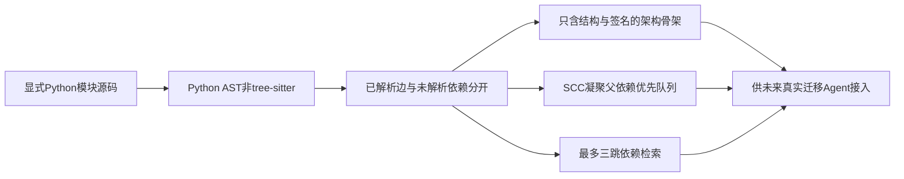
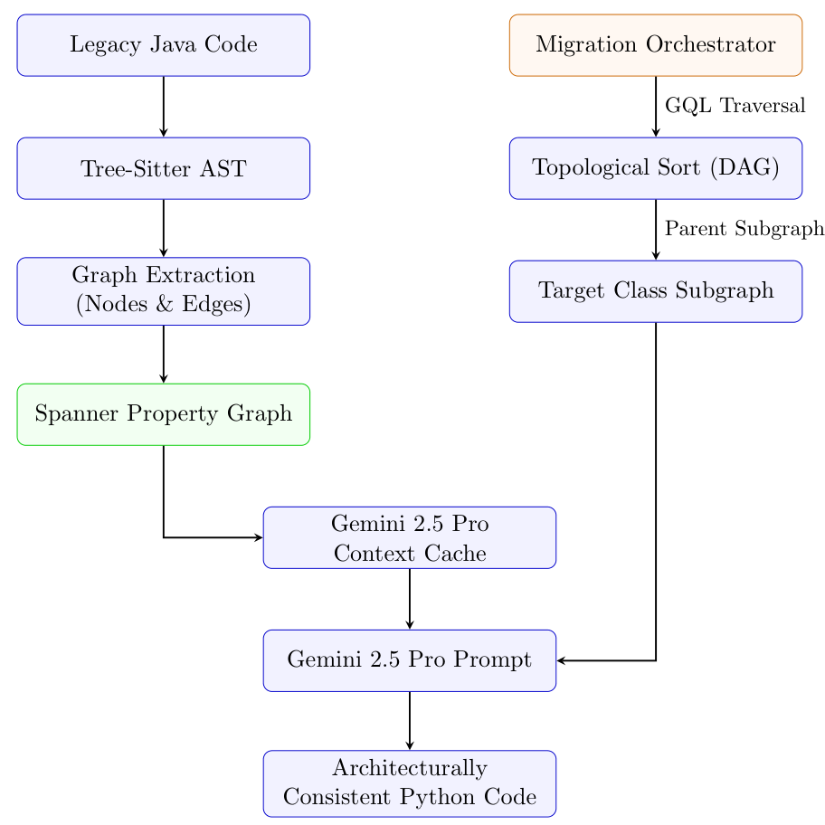

# HCRG：先构建依赖上下文，再进行代码迁移

> `component_only` / L0，**仅 Python AST 支持的 graph 子系统**。不是 Java tree-sitter 管线或真实 LLM 跨语言迁移复现。完整实验：**成本过高，不复现（审查 DONE）**。

## 论文信息

| 字段 | 内容 |
| --- | --- |
| 论文链接 | [arXiv 2609.12464](https://arxiv.org/abs/2609.12464)，[v1 §3–5](https://arxiv.org/html/2609.12464v1#S3) |
| 公司/机构 | 一作 Nilesh Jaiswal：Google Cloud（原文作者区列 Google 邮箱及 Google Cloud；不再仅写“官方收录、机构未核”） |
| 首次公开日期 | 2026-09-11 05:54:41 UTC（arXiv v1；首页的 April 6 不是 arXiv 首发日期） |
| 原文开源代码 | 已读正文与 Google 条目未找到作者 pipeline；spring-petclinic 输入仓库不等于作者实现 |
| 本地 Adapter | 无；独立组件 `hcrg` |
| 本地复现代码 | `src/auto_research/agent_research/google16_hcrg.py` |

## 原始论文总结

### 背景与主要改动

HCRG 用 AST 提取 INHERITS/CALLS/IMPORTS，缓存全局架构骨架，按父依赖先后迁移，三跳取回结构上下文。原文对照是 800 字符/150 overlap/top-5 向量 RAG。[§3–4](https://arxiv.org/html/2609.12464v1#S3)



<!-- paper-figure:start -->
### 原论文关键图

[](https://arxiv.org/pdf/2609.12464v1#page=5)

> 原论文 v1 Figure 2，第5页；版权归作者。tree-sitter、Spanner与Gemini云路径未在本地实现，不能用Python图组件冒称完整图中管线。[截图来源记录](assets/provenance.json)

图片来自[原论文](https://arxiv.org/abs/2609.12464)，版权归原作者所有。
<!-- paper-figure:end -->

### 核心公式

局部结构上下文为 $N_{\le3}(v)$，父依赖优先次序要求已解析边 $v\to p$ 满足 $p$ 先于 $v$；若形成环，则返回强连通分组，不假称组内存在拓扑次序。原文未给出完整 cycle-breaker，不能捏造它。

### 论文离线与线上效果

单个 Java→Python repo 的 DRQ 34.8%→65.9%、PCC 26.7%→45.5%，但复杂度一致性 71.6%→46.7%。未报告生产 A/B、多 repo 或多 seed 泛化。[§6](https://arxiv.org/html/2609.12464v1#S6)

## 本地复现

```bash
PYTHONPATH=src python -m pytest tests/test_google16_hcrg.py
```

### 数据协议与结果

8 项 Python 自建源码机制测试通过：跨模块继承、三跳边界、签名骨架、父依赖顺序、显式循环组、缓存与部分静态指标，以及未导入跨模块同名、参数/局部变量shadow、歧义和外部依赖保留。[诊断记录](metrics/component-contract.json)

### 代码映射与边界

`extract_python_graph` 不执行/导入输入代码；模块最多 64 个、每模块 100,000 字符。只支持本模块或显式import后可解析的顶层类/函数依赖，不按全repo同名猜测；参数、局部赋值等shadow的调用不会误连同名全局符号。不能解析的符号保存在 `unresolved_dependencies`；方法签名入骨架但动态调用、反射和 Java语法不支持。`dependency_order` 保留 SCC 环，`retrieve` 明确最多 3 hops。`SkeletonCache` 是本地内容哈希缓存，**不是 Vertex AI Context Cache**。

`static_metrics` 仅提供 Python→Python 参考结构下的 PCC/THC/受控 import DRQ、语法解析、docstring presence；未实现 Java复杂度、pyflakes、完整 API hallucination 或 MQ 聚合。Python AST替代及这些简化均显式暴露，不把指标凑成论文七项。没有 LLM 迁移、云服务、语义向量 fallback 或端到端重建，没有 GPU 或 Evolve 路径。

### 成本决定

完整管线需要 tree-sitter Java、Spanner图、Vertex嵌入/一小时context cache及Gemini2.5Pro整repo迁移。作者实现不可得，整repo云模型 token/runtime 也无法用廉价核对确定为单卡短验可负担；按项目成本不确定规则关闭，**成本过高，不复现（审查 DONE）**。不以纯图测试冒充廉价端到端复现。
