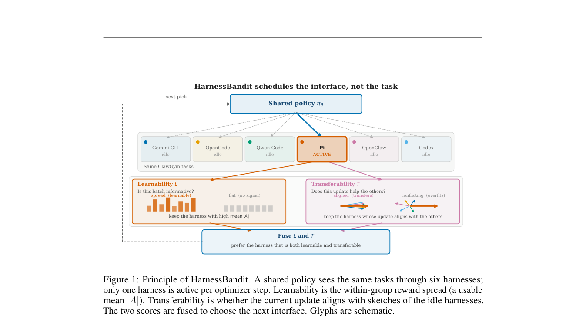

# HarnessBandit: Joint Learnability-Transferability Scheduling for Multi-Harness Agentic Reinforcement Learning

<!-- source-sha256: e79d825a83fef831d78335941a056c13d2abcb9cfdc27c94012a366b7ca6773b -->

[简体中文](README.md)

> L1 online harness scheduling only; no large-model RL.

## Paper information

| Field | Details |
|---|---|
| Paper | [HarnessBandit: Joint Learnability-Transferability Scheduling for Multi-Harness Agentic Reinforcement Learning](https://arxiv.org/abs/2609.13739) |
| Institution | Harbin Institute of Technology / Alibaba Cloud (first author). |
| First public release | 2026-09-12 (arXiv v1) |
| Author code | No public author repository found as of 2026-09-16. |
| Local adapter or method key | `harness-bandit` |
| Local reproduction code | [`src/auto_research/agent_research/latest_20260916.py`](https://github.com/daiwk/auto-research/blob/main/src/auto_research/agent_research/latest_20260916.py) |

## Paper method and evidence

Allocate multi-harness training budget by combining learnability, transferability and an exploration bonus. The reference kernel retains gating and weight/state updates and exposes intermediate values for matched-budget comparisons.

<!-- paper-figure:start -->
### Original paper figure

Figure 1 shows the multi-harness scheduler. From the [original paper](https://arxiv.org/abs/2609.13739); copyright remains with the authors.
<!-- paper-figure:end -->

### Core equation

The local kernel reports decisions and state changes at each allocation; fixed seeds and budget establish invariants only.

### Reported results

Paper capability, latency, and cost results are not directly comparable to these local fixtures.

## Local reproduction

[Three-seed mechanism results](metrics/mechanism-seeds42-44.json) are diagnostic_only=true. Fixed-budget fixtures verify the defining operator and auditable intermediate states; they are not a benchmark, production result, or capability-ranking entry.
