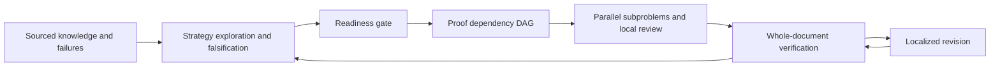
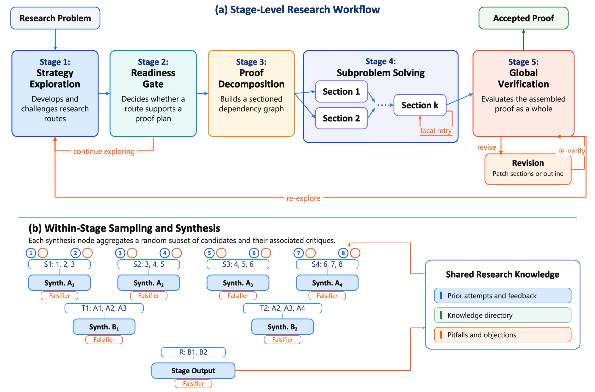

<!-- source-sha256: 64562b4d44dc2fccd08df5c2ca93814521d0777b5b8b3a794a4fc46ffb5be122 -->
# Stellar Colosseum: long-horizon multi-agent research with falsification evidence

[简体中文](README.md)

> **review_only: historical Google-priority backfill.** The full semantic research campaign is too costly and not reproduced (review DONE). Generic trees/DAGs do not stand in for proof capability.

## Paper information

| Field | Value |
| --- | --- |
| Paper | [Stellar Colosseum](https://arxiv.org/abs/2609.15983v1), [fixed v1](https://arxiv.org/html/2609.15983v1) |
| Institution | First author Honghao Lin, Google Research; co-first author David P. Woodruff additionally lists Carnegie Mellon University. This does not replace the first affiliation |
| Original publication | **2026-09-14 17:58:55 UTC**; historical backfill. The November13 blog is new discovery evidence, not a first release or revision |
| Authors' code | The paper links [erdos results](https://github.com/dpwoodru/erdos) and [knuthCycles results](https://github.com/dpwoodru/knuthCycles), but no verifiable general Colosseum harness release was found. Research-result repositories are not system source |
| Local adapter / key | `stellar-colosseum`; `adapter=null`; no executable operator or Evolve integration |
| Local code | **None**; method record at `src/auto_research/paper_specs/catalog/agent-research/stellar-colosseum.json` and documentation only |

## Original paper

### Motivation and changes

Long proofs fail through immature strategies, incompatible assumptions, cyclic dependencies or inherited attacked claims, not merely weak individual reasoning. Colosseum explores strategies, gates readiness for stable decomposition, solves a dependency DAG with local review/retries, and globally verifies the assembled argument before revision or renewed exploration.

Within each stage, candidates remain bundled with targeted falsification. Aggregators sample distinct inputs without replacement inside each group, independently across groups, allowing overlap. Synthesis preserves objections rather than averaging votes. Shared knowledge retains sourced lemmas, failed approaches, references and observations with caveats.

### Architecture

<!-- paper-figure:start -->
### Key original figure

From [fixed v1 Figure1](https://arxiv.org/html/2609.15983v1#S0.F1). The official SVG was rasterized with PyMuPDF without content changes; provenance records the original hash and process. Copyright remains with the authors. The upper panel shows research stages/repair paths; the lower panel shows overlapping candidate–critique synthesis.
<!-- paper-figure:end -->

### Core equations

$$
G_j^{(\ell)}\sim Unif\{G\subseteq\mathcal C^{(\ell)}:|G|=k_\ell\},\quad
s_j^{(\ell+1)}=A(x,K,G_j^{(\ell)}).
$$

Expected reuse is $m_{\ell+1}k_\ell/m_\ell$. Aggregation is an external semantic research agent, not scalar averaging or selecting the largest score. Failure to find a counterexample is not proof; a specific fatal objection can reject a proof despite generic approvals.

### Author results

On300 TCS-Bench tasks, Section6 reports54.0% and55.0% for separate Gemini3.1Pro/3.7Flash systems. Eight independent critiques select the Pro proof if at least five approve, otherwise Flash, yielding71.0%. Oracle best-of-two77.3% is an upper bound, not an executable selector. Reference proofs are only for the final benchmark grader, never actors or the selection rule.

On222 Codeforces tasks, Section7 reports218 accepted with an execution probe versus213 without. Revision budgets also differ and the final probe-to-revision path was not independently validated, so this is not an isolated causal probe effect. The4263 figure is an explicitly calibrated corpus performance number, not an official contestant rating. No production A/B is reported.

## Local reproduction

### Protocol and code mapping

Only fixed-v1 methods, costs, figures and bilingual learning content are collected. Semantic strategy/readiness models, proof graders, Long Proof runtime, Codeforces execution and TCS-Bench integration are absent. No runtime, capability metrics or GPU receipt exists.

The [November13 official Google blog](https://research.google/blog/advancing-science-engineering-with-antigravitys-teamwork-feature/) links this paper from its Long Proof pattern. It provides historical-priority discovery evidence without moving the original publication date. Cards/catalogs retain the v1 date.

### Full experiment and limits

Section4.4 uses32→16→8→5→1 exploration widths and16→8→5→1 for other stages, drawing up to five inputs; open research sometimes exceeds100 leaves. Actual calls additionally depend on sections, retries and revisions. Sections6/7 use paid Gemini long workflows for300 proofs and222 programming problems plus two-model candidates/eight critiques. **Too costly; not reproduced (review DONE)**. No paid probes, weights/data or retries; a generic sampling tree would not implement the defining semantics.
