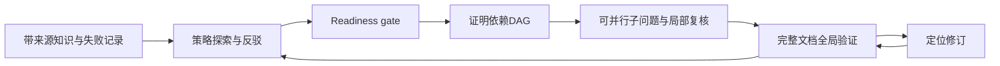
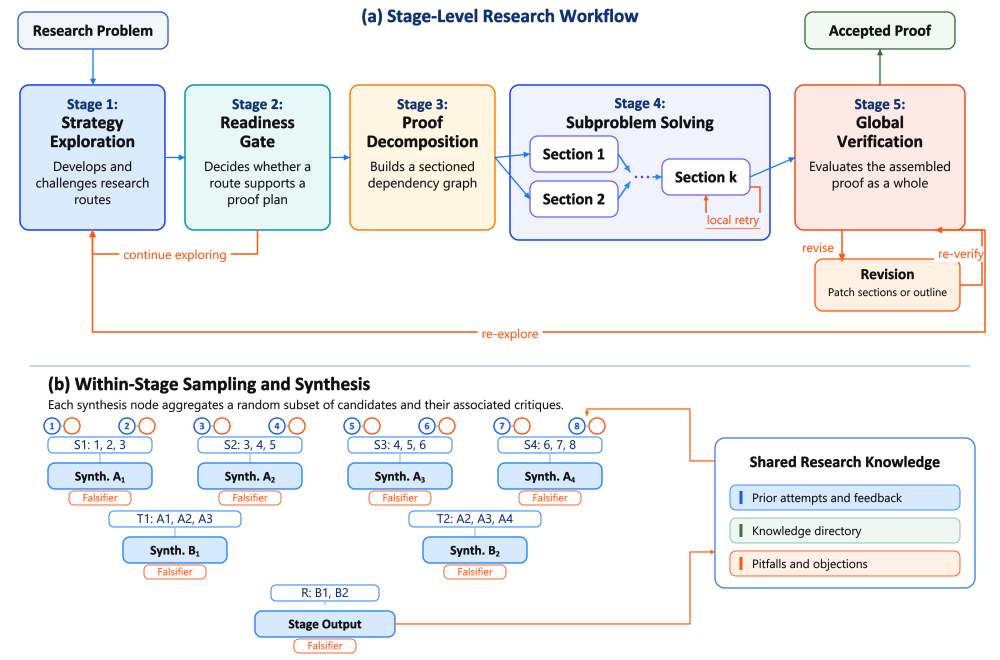

# Stellar Colosseum：带反驳证据的长程多Agent科学研究

[English](README-en.md)

> **review_only：历史Google高优先补漏，仅资料收录。** 完整语义研究实验成本过高，不复现（审查 DONE），不以通用tree／DAG组件冒充证明能力。

## 论文信息

| 字段 | 内容 |
| --- | --- |
| 论文链接 | [Stellar Colosseum](https://arxiv.org/abs/2609.15983v1)，[固定v1原文](https://arxiv.org/html/2609.15983v1) |
| 公司 / 机构 | 一作 Honghao Lin，Google Research；共同一作David P. Woodruff另署Carnegie Mellon University，不改变第一机构 |
| 首次公开日期 | **2026-09-14 17:58:55 UTC**；历史补漏，11月13日官方博客为新发现来源，不是论文新首发或新修订 |
| 原作者代码 | 原文链接[erdos研究结果](https://github.com/dpwoodru/erdos)及[knuthCycles结果](https://github.com/dpwoodru/knuthCycles)，未找到可核实通用Colosseum harness源码；结果仓库不等于系统实现开源 |
| 本地 adapter / key | `stellar-colosseum`；`adapter=null`，无可执行operator，未接入Evolve |
| 本地复现代码 | **无**；仅 `src/auto_research/paper_specs/catalog/agent-research/stellar-colosseum.json` 方法规格与本页资料 |

## 原始论文总结

### 背景与主要改动

长证明失败不仅是单步推理不够好，还可能路线不成熟、子问题假设不匹配、跨节依赖循环，或把已被攻击的结论传下去。Colosseum先探索策略，经readiness gate确定路线能否支持稳定的证明结构，再分解为依赖DAG；独立节并行求解，局部失败重试，完整文档再全局核查，必要时重新探索。

每阶段也不是单模型一次生成：候选和针对它的falsification记录成对进入树综合。每个综合节点独立随机抽取若干不同输入，组间可重叠而非分区；综合保留冲突和反驳，不按票数把异议平均掉。知识目录记录定理、失败路径、参考和观察，保留来源及限制。

### 架构与流程

<!-- paper-figure:start -->
### 原论文关键图

图片来自[原论文](https://arxiv.org/html/2609.15983v1#S0.F1)固定v1 Figure 1。官方SVG经PyMuPDF栅格化，未改图内容，原SVG哈希与处理方式见provenance；版权归原作者所有。上半为研究阶段及返工路径，下半为重叠候选／反驳综合。
<!-- paper-figure:end -->

### 核心公式

$$
G_j^{(\ell)}\sim Unif\{G\subseteq\mathcal C^{(\ell)}:|G|=k_\ell\},\quad
s_j^{(\ell+1)}=A(x,K,G_j^{(\ell)}).
$$

每组内无放回、组间独立可重叠；一个节点的期望复用次数为 $m_{\ell+1}k_\ell/m_\ell$。$A$是对候选及其反驳进行语义综合的外部研究Agent，不是标量平均／选最大值。找不到反例也不能证明正确；一个明确致命反驳足以拒绝，全局验证不是多数表决。

### 论文离线与线上效果

§6在300题TCS-Bench报告Gemini3.1Pro和3.7Flash两套系统分别54.0%和55.0%；以8次独立critique、至少5次认可来选择3.1Pro，否则选Flash，达到71.0%。77.3%是oracle best-of-two上界，不是可执行选择器。参考proof只给最终benchmark grader，不能给actor／选择规则。

§7在222题Codeforces报告加入执行probe配置218题通过、无probe配置213题；两臂revision预算也不同，最终probe→revision路径未独立验证，因此不是隔离出的probe因果效应。4263为作者明示校准的corpus性能数，不是官方选手rating。未报告生产线上A/B。

## 本地复现

### 数据协议与代码映射

仅固定v1资料、成本、原图和双语学习内容，没有语义策略器、readiness gate模型、证明grader、Long Proof运行时、Codeforces执行器或TCS-Bench接入。无runtime、能力metrics或GPU收据。

[Google 11月13日官方博客](https://research.google/blog/advancing-science-engineering-with-antigravitys-teamwork-feature/)的Long Proof pattern直接引用本篇，是历史优先源补漏的证据；它不能把原始日期改成11月。学习卡片与目录按原始v1日期记录。

### 高成本完整实验与边界

§4.4表1探索树宽32→16→8→5→1，其余阶段16→8→5→1、每次最多抽5个输入；开放研究探索有时超过100叶。实际调用数还乘证明节、局部重试和返工。§6／7使用收费Gemini长流程覆盖300证明与222编程题，还含跨模型候选和八次critique。**成本过高，不复现（审查 DONE）**；未做收费调用／权重数据下载／估价试跑，也不把通用采样树包装成核心语义实现。
