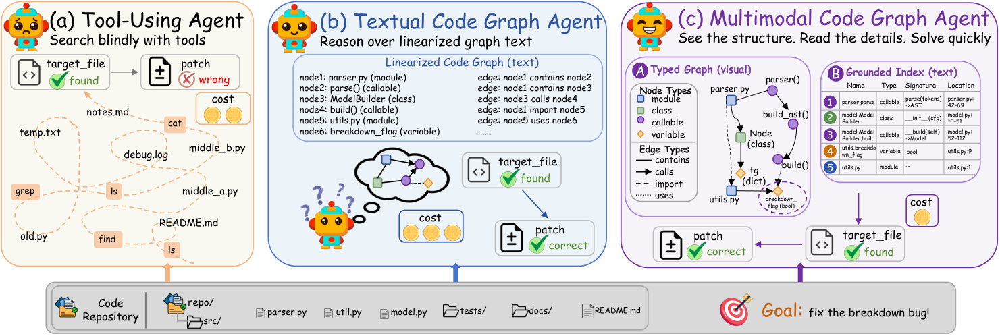

# RepoAtlas: Guiding Coding Agents via Evolving Multimodal Repository Views

<!-- source-sha256: 148b960a2764a1a0c5679bb05f367c6b519872ed6a38474edd963d10c77500a0 -->

[简体中文](README.md)

> L1 bounded text view over public observations; no real SWE-bench browser integration.

## Paper information

| Field | Details |
|---|---|
| Paper | [RepoAtlas: Guiding Coding Agents via Evolving Multimodal Repository Views](https://arxiv.org/abs/2609.16936) |
| Institution | Beihang University (first author). |
| First public release | 2026-09-15 (arXiv v1) |
| Author code | No public author repository found as of 2026-09-16. |
| Local adapter or method key | `repoatlas` |
| Local reproduction code | [`src/auto_research/agent_research/latest_20260916_followup.py`](https://github.com/daiwk/auto-research/blob/main/src/auto_research/agent_research/latest_20260916_followup.py) |

## Paper method and evidence

Under a fixed budget, select a relevant code subgraph, project it into a visual topology and exact text index, and refresh both views as the task evolves.

<!-- paper-figure:start -->
### Original paper figure

Figure 1 introduces the evolving repository views. From the [original paper](https://arxiv.org/abs/2609.16936); copyright remains with the authors.
<!-- paper-figure:end -->

### Core equation

The reference exposes selection and state changes without treating a fixture as coding ability.

### Reported results

The paper's benchmark and speed measurements are not local scores or online estimates.

## Local reproduction

[Three-seed mechanism results](metrics/mechanism-seeds42-44.json) are diagnostic_only=true. Fixed-budget fixtures verify the defining operator and auditable intermediate states; they are not a benchmark, production result, or capability-ranking entry.
