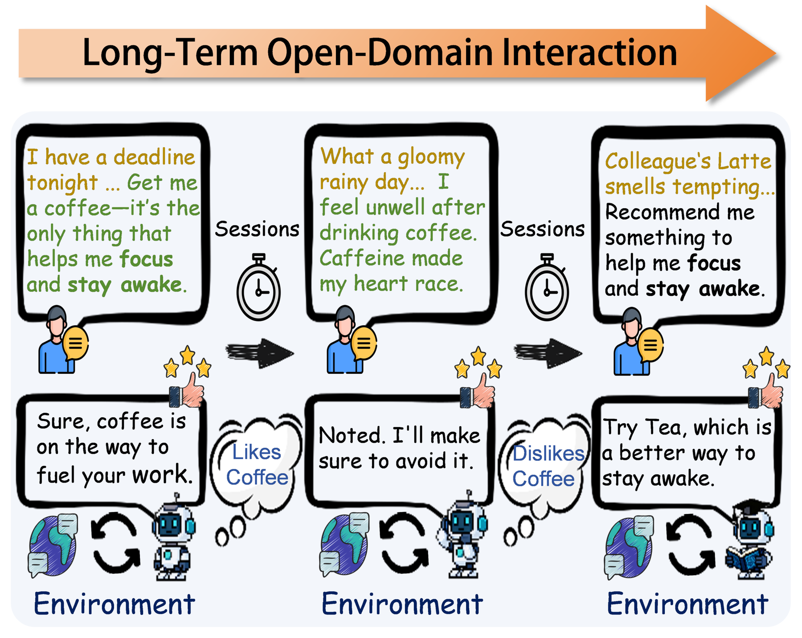

# Interactive Memory Learning for Long-Term Conversations

<!-- source-sha256: 06058e8505e1a82b05d1451a4291209bb1ef61cbec5964ba17da3f1e8c22be06 -->

[简体中文](README.md)

> L1 observation-safe Planner/Trigger delayed-reward state machine; no paper-scale dialogue training.

## Paper information

| Field | Details |
|---|---|
| Paper | [Interactive Memory Learning for Long-Term Conversations](https://arxiv.org/abs/2609.17088) |
| Institution | Harbin Institute of Technology, Shenzhen / Pengcheng Laboratory (first author). |
| First public release | 2026-09-15 (arXiv v1) |
| Author code | No public author repository found as of 2026-09-16. |
| Local adapter or method key | `interactive-memory` |
| Local reproduction code | [`src/auto_research/agent_research/latest_20260916_followup.py`](https://github.com/daiwk/auto-research/blob/main/src/auto_research/agent_research/latest_20260916_followup.py) |

## Paper method and evidence

The Planner selects high-value information to write, the Trigger decides when to retrieve it, and delayed cross-session reward trains the two policies together.

<!-- paper-figure:start -->
### Original paper figure

Figure 1 shows the planner, trigger, and cross-session interaction. From the [original paper](https://arxiv.org/abs/2609.17088); copyright remains with the authors.
<!-- paper-figure:end -->

### Core equation

The local reference exposes gate and state changes for fixture checks.

### Reported results

Paper accuracy, training losses, and benchmark results are not directly comparable to the local diagnostic.

## Local reproduction

[Three-seed mechanism results](metrics/mechanism-seeds42-44.json) are diagnostic_only=true. Fixed-budget fixtures verify the defining operator and auditable intermediate states; they are not a benchmark, production result, or capability-ranking entry.
