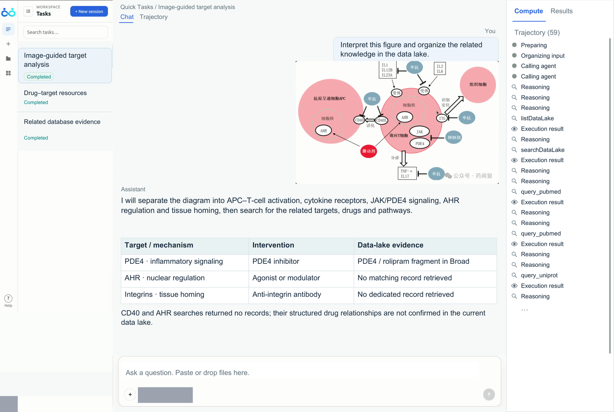

<!-- source-sha256: b60ba6af53eb1e9849108f395313211214607686ad5c98fa51482a9a1bdef737 -->

[简体中文](README.md) · English

# ScienceBuddy: Recursive-in-Recursive Self-Improvement for Interactive Scientific Agents

> **L1 core mechanism diagnostic.** The local implementation runs two levels of state updates, with no actual lab connection.

## Paper information

| Field | Details |
|---|---|
| Paper | [ScienceBuddy: Recursive-in-Recursive Self-Improvement for Interactive Scientific Agents](https://arxiv.org/abs/2609.17523) |
| Institution | Gen-Verse research collaboration (first author affiliation) |
| First public release | 2026-09-15 (arXiv v1) |
| Original source code | Yes: [Gen-Verse/ScienceBuddy](https://github.com/Gen-Verse/ScienceBuddy) |
| Adapter/method | `sciencebuddy` |
| Local reproduction code | [`src/auto_research/agent_research/latest_20260916.py`](https://github.com/daiwk/auto-research/blob/main/src/auto_research/agent_research/latest_20260916.py) |

## Original paper summary

### Background and main changes

The inner recursion evolves the interaction harness. The outer recursion updates the scientific agent's policy from successful trajectories.

The local reference kernel retains the defining gates, weights or state transitions and emits auditable intermediates for comparison under a shared budget.

<!-- paper-figure:start -->
### Key figure from the paper

> **Figure 4:** Core architecture, modules and connections. From the [paper](https://arxiv.org/abs/2609.17523); copyright belongs to the authors. Click for the source.
<!-- paper-figure:end -->

### Core mechanism

The implementation preserves the defining state transitions and exposes relevant weight, gate, depth, stage or cache statistics. Fixed budgets and three seeds check mechanism invariants, not paper-scale training.

### Offline and online results

Capability, speed and cost claims are attributed to the paper only. Local results are not directly compared or extrapolated to online gains.

## Local reproduction

See [`metrics/mechanism-seeds42-44.json`](metrics/mechanism-seeds42-44.json). The unified receipt marks `diagnostic_only=true`, so the public dashboard does not treat it as a full capability gain.

### Scope

Two levels of state updates run locally. There is no connection to an actual lab environment.
