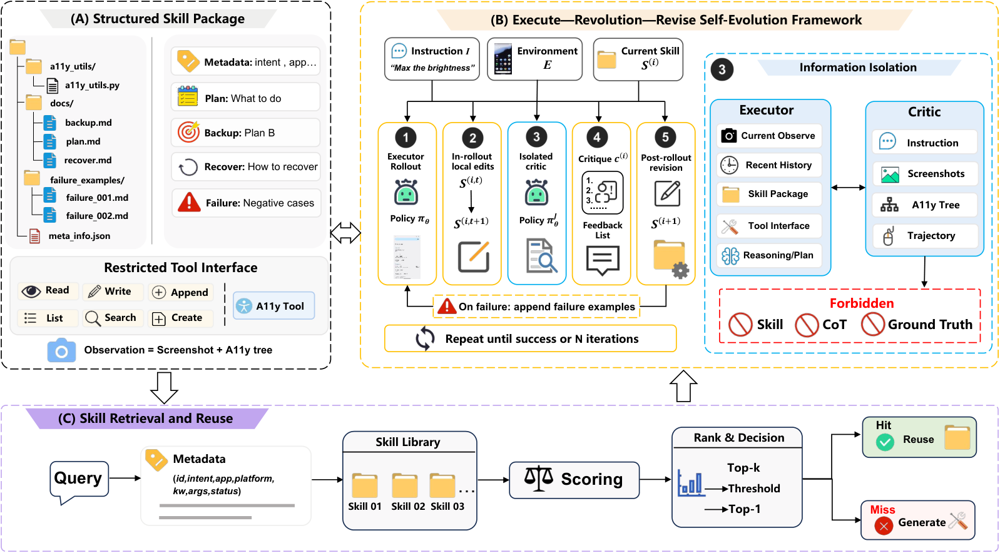

<!-- source-sha256: 608a3a0fbb790b474cf0a858b14501f99bd024065d843642a391ce110ea47649 -->

[简体中文](README.md) · English

# Reflect, Revise, Reuse: Training-Free Skill Evolution for GUI Agents

> **L1 core mechanism diagnostic.** Uses only public observations to demonstrate bounded skill revision. No MobileWorld, AndroidWorld or OSWorld run.

## Paper information

| Field | Details |
|---|---|
| Paper | [Reflect, Revise, Reuse: Training-Free Skill Evolution for GUI Agents](https://arxiv.org/abs/2609.17653) |
| Institution | Zhejiang University (first author affiliation) |
| First public release | 2026-09-15 (arXiv v1) |
| Original source code | Yes: [ZJU-REAL/EvoSkill-GUI](https://github.com/ZJU-REAL/EvoSkill-GUI) |
| Adapter/method | `evoskill-gui` |
| Local reproduction code | [`src/auto_research/agent_research/latest_20260919.py`](https://github.com/daiwk/auto-research/blob/main/src/auto_research/agent_research/latest_20260919.py) |

## Original paper summary

### Background and main changes

Split GUI skills into editable components. After execution fails, a critic with isolated information reflects on the failure and revises only the responsible component. Verified skills can be reused on other tasks.

<!-- paper-figure:start -->
### Key figure from the paper

> **Figure 2:** Core architecture, modules and connections. From the [paper](https://arxiv.org/abs/2609.17653); copyright belongs to the authors. Click for the source.
<!-- paper-figure:end -->

### Core mechanism

The reference kernel retains defining gates, weights, state transitions or scheduling rules and records intermediates in metrics. See implementation functions and test invariants for variable and formula mappings.

### Offline and online results

The paper's online, benchmark, training-efficiency and inference-speed results are author results only. The [local three-seed artifact](metrics/mechanism-seeds42-44.json) checks the core mechanism, shapes and state invariants, not paper-level scores.

## Scope

Local evidence comes only from public observations and demonstrates bounded skill revision. MobileWorld, AndroidWorld and OSWorld were not run.
