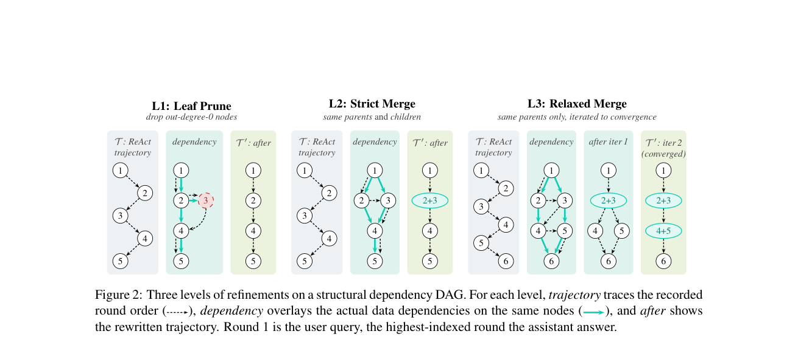

# Dependency-Aware Trajectory Refinement for Efficient Multi-Turn Agent Fine-Tuning

<!-- source-sha256: 02c439122a4f8bc315fc8a9782f7e90bb29286dbd85e69d284cf68618856cef8 -->

[简体中文](README.md)

> **L1 core-mechanism diagnostic.** Runs dependency pruning and merging on auditable fixture DAGs, not an LLM annotator.

## Paper information

| Field | Details |
|---|---|
| Paper | [Dependency-Aware Trajectory Refinement for Efficient Multi-Turn Agent Fine-Tuning](https://arxiv.org/abs/2609.18417) |
| Organization | First-author affiliation: ShanghaiTech University |
| First public release | 2026-09-16 (arXiv v1) |
| Authors' code | [Alibaba-NLP/VLLM-KB](https://github.com/Alibaba-NLP/VLLM-KB) is public. |
| Adapter / method | `dependency-refinement` |
| Local reproduction code | [`src/auto_research/agent_research/latest_20260919.py`](https://github.com/daiwk/auto-research/blob/main/src/auto_research/agent_research/latest_20260919.py) |

## Original paper

### Motivation and method

Represent multi-turn trajectories as a turn-level dependency DAG. Prune leaves, merge under strict rules, then merge under looser rules to remove redundant messages without deleting final-answer dependencies.

~~~mermaid
flowchart LR
  I[Public input and current state] --> M[dependency-refinement mechanism]
  M --> A[Auditable intermediates]
  A --> O[Output or state update]
~~~

<!-- paper-figure:start -->
### Key figure from the paper

> **Figure 2:** Overview of the paper's method and its key components. From the [original paper](https://arxiv.org/abs/2609.18417); copyright remains with the authors. Click the image for the source.
<!-- paper-figure:end -->

### Core computation

The local reference kernel preserves the paper's decisive gates, weights, state transitions, or scheduling rules and records intermediates in the metrics artifact. Implementation functions and invariant assertions in tests map the formulas and variables.

### Paper results

Reported online results, benchmarks, training efficiency, or inference speed are original paper results. The local [three-seed artifact](metrics/mechanism-seeds42-44.json) checks core mechanisms, shapes, and state invariants without comparing directly to the paper's numbers.

## Reproduction boundaries

Dependency pruning and merging run locally. The DAG comes from an auditable fixture and is not produced by an LLM annotator.
