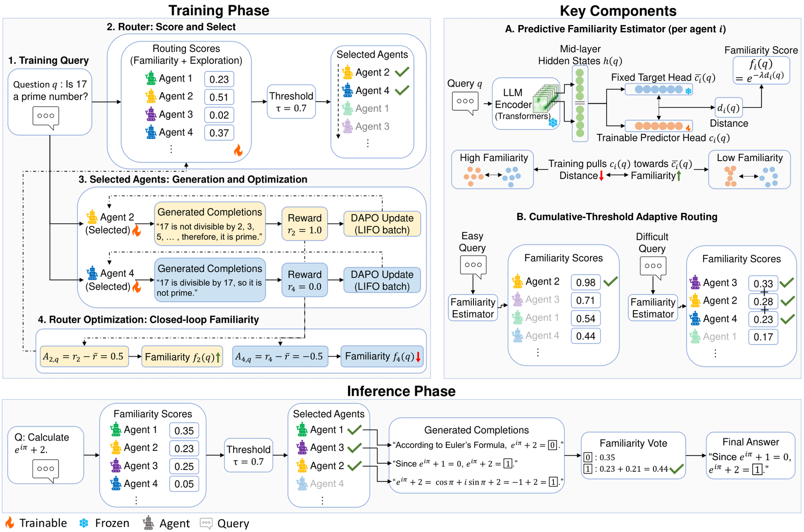

# CERA-MoA: Co-Evolving Router and Agents for Mixture-of-Agents

<!-- source-sha256: 368fe3fe93846cd3e464db2c3851d5afce0ca9244046e32a35686ff67b3c447d -->

[简体中文](README.md)

> **L1 core-mechanism diagnostic.** Executes familiarity-based routing and targeted updates, not paper-scale expert-policy training.

## Paper information

| Field | Details |
|---|---|
| Paper | [CERA-MoA: Co-Evolving Router and Agents for Mixture-of-Agents](https://arxiv.org/abs/2609.18779) |
| Organization | First-author affiliation: IIIS, Tsinghua University |
| First public release | 2026-09-16 (arXiv v1) |
| Authors' code | No public author implementation repository was found as of 2026-09-19. |
| Adapter / method | `cera-moa` |
| Local reproduction code | [`src/auto_research/agent_research/latest_20260919.py`](https://github.com/daiwk/auto-research/blob/main/src/auto_research/agent_research/latest_20260919.py) |

## Original paper

### Motivation and method

Estimate each agent's familiarity with an example from intermediate-layer hidden states. Select experts adaptively via a cumulative threshold and direct training examples to the corresponding experts.

~~~mermaid
flowchart LR
  I[Public input and current state] --> M[cera-moa mechanism]
  M --> A[Auditable intermediates]
  A --> O[Output or state update]
~~~

<!-- paper-figure:start -->
### Key figure from the paper

> **Figure 1:** Overview of the paper's method and its key components. From the [original paper](https://arxiv.org/abs/2609.18779); copyright remains with the authors. Click the image for the source.
<!-- paper-figure:end -->

### Core computation

The local reference kernel preserves the paper's decisive gates, weights, state transitions, or scheduling rules and records intermediates in the metrics artifact. Implementation functions and invariant assertions in tests map the formulas and variables.

### Paper results

Reported online results, benchmarks, training efficiency, or inference speed are original paper results. The local [three-seed artifact](metrics/mechanism-seeds42-44.json) checks core mechanisms, shapes, and state invariants without comparing directly to the paper's numbers.

## Reproduction boundaries

Familiarity-based routing and targeted updates run locally. Paper-scale expert policies were not trained.
