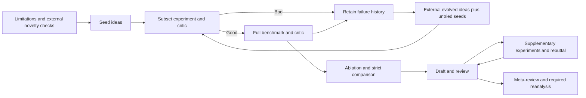
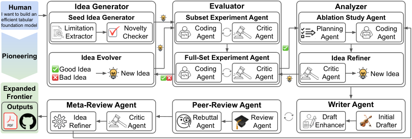

# ScientistTwo: bounded experiment escalation, ablation, and review control

<!-- source-sha256: 7dc069b4eafe45c0c793e19deeb6ce40815fa4bf2685a52ba3e0f54e8f642073 -->

[简体中文](README.md)

> **L1 CPU control contracts, not a complete autonomous scientist.** Models, research-code execution, novelty, method judgments, and writing remain external. Fixed callbacks verify scheduling and budgets only. The expensive complete study is not reproduced (review DONE).

## Paper information

| Field | Value |
| --- | --- |
| Paper | [ScientistTwo: Pioneering the Human Knowledge Frontier with Autonomous AI](https://arxiv.org/abs/2609.19644v1); [fixed v1](https://arxiv.org/html/2609.19644v1); [author project](https://scientist-two.github.io/) |
| Institution | First author Jaehyun Nam: Google Cloud AI Research |
| Original publication | **September 17, 2026, 03:37:42 UTC**; a historical discovery repair, not a November 13 first release |
| Authors' code | No verifiable complete ScientistTwo framework repository was found in fixed v1 or the official project. Its generated-paper gallery, solver artifacts, third-party replicas, and reused PaperOrchestra/ScholarPeer components do not establish release of the full system |
| Local adapter/key | `scientist-two`; `adapter=null`; no Evolve integration |
| Local code | `src/auto_research/agent_research/scientist_two.py` |

## Original paper

### Motivation and changes

ScientistTwo extracts limitations, proposes novelty-ranked ideas, reproduces a subset baseline, and engineers candidates. Only a subset Good unlocks the full benchmark. Later ideas use both successful and failed experimental history, plus untried high-novelty seeds, rather than exploiting only early winners.

After full evaluation, the system performs ablations, strict result comparison, drafting, supplementary-experiment rebuttals, and meta-review. Simplifying a method or answering a reviewer does not automatically improve it. Only externally verified strict superiority updates the best candidate and restarts downstream analysis.

### Flow



<!-- paper-figure:start -->
### Key original figure

[](https://arxiv.org/html/2609.19644v1/scientisttwo_overview.png)

Source: [fixed paper](https://arxiv.org/html/2609.19644v1#S1.F3). Copyright remains with the authors. Official HTML Figure 3 PNG bytes are retained without redrawing, cropping, or rendering. Its model, experiment, and writing agents are not implemented locally.
<!-- paper-figure:end -->

### Equations and budgets

The next pool combines external evolved proposals with untried seeds:

$$
\mathcal H_k=\mathcal I_k\cup\mathcal H_0^{(k)},\qquad
\mathbf R_{<k}=\bigcup_{i<k}\mathcal R_i.
$$

Retain Good and Bad evidence. Good is an external semantic judgment, not a fixed scalar threshold supplied here. Stop early at the target number of successes. With no full-set Good at exhaustion, terminate; with some successes, delegate selection rather than inventing a multi-metric aggregate.

$$
best\leftarrow proposed\quad\text{iff external comparison certifies strict superiority}.
$$

Figure 4 accepts immediately, rejects immediately, or refines under a bounded number of critic calls. Its literal pseudocode refines even after the final critic verdict, but then returns None without acceptance. Critic calls and engineering-refinement calls are different budget units; an unreviewed final artifact cannot silently become successful.

Appendix A.2 allows up to sixteen limitation-extraction rounds, one seed and one evolved idea per experimentation round, four rounds or four successes, two engineering refinements, one ablation refinement, two peer-review rounds with early stopping at score eight, and one review-driven idea refinement. Local `review_rebuttal` explicitly budgets review calls and only rebuts while a follow-up review slot remains. It is not the complete meta-review pipeline.

### Paper evidence

The authors report 86 successful artifacts from 107 problems (80.4%) and 25.2% average relative gain over human baselines among successful cases. Generated papers score 7.5/10 under ScholarPeer and 5.7/10 under Stanford Agentic Reviewer. ScholarPeer also guides draft refinement and is in-distribution; the authors treat Stanford's reviewer as unseen during development. Simulated acceptance is not actual conference acceptance or a matched-cost guarantee across systems.

The human study covers 33 NeurIPS-derived papers and nine experts. Overall relative preference is approximately parity with human papers, and methodological rigor does not win every comparison. No production-traffic A/B is reported. Local callbacks are not ranked alongside the authors' scientific-success rates.

## Local component

### Data contract and code

| Kernel | Executed behavior and external responsibility |
| --- | --- |
| `run_stage` | Bounded Figure 4 control, preserving artifacts/critiques; no semantic critic |
| `promote_subset` | Subset Good alone unlocks full execution; full Bad/Engineer remains unchanged |
| `build_round` | Complete Good/Bad history goes to an external evolver; add untried seeds using external novelty |
| `search_decision` | Continue, delegate selection, or stop without success; only full-set Good counts |
| `strict_refinement` | An explicit external strict-improvement boolean governs replacement; ties or unestablished gains preserve the original object |
| `review_rebuttal` | External 1–10 scores, default threshold eight and two review calls; no review generation, experimental rebuttal, or manuscript writing |

Inputs are explicit evidence references and judgments, not gold answers or hidden target plans. A reference does not prove execution; callbacks are not secure sandboxes. The caller still audits protocols, data isolation, execution and semantic truth. In-stage revisions retain idea identity, and evaluated ideas cannot be counted repeatedly as new successes. ID ordering for novelty ties is a local deterministic convention.

```bash
PYTHONPATH=src python -c 'from auto_research.agent_research.scientist_two import diagnostic; print(diagnostic(42))'
PYTHONPATH=src python -m pytest tests/agent_research/test_scientist_two.py -q
```

### Evidence and negative controls

Explicit callback truth tables test refinement followed by acceptance, discarded unreviewed final artifacts, rejection stopping, Engineer not bypassing full evaluation, preserved full-set failure, complete success/failure history, strict-improvement replacement, and review thresholds/budgets. Seeds only shuffle seed input order. External errors and invalid types propagate or fail closed, never become scientific success.

The frozen source was actually executed on CPU with seeds 42, 43 and 44, and all control checks passed; see [three-seed control metrics](metrics/component-cpu-seeds42-44.json) and the unified frozen-source receipt. These are callback contracts, not scientific-task success rates or training timings. CUDA is rejected and no GPU receipt is required.

## Reproduction boundaries

This is CPU control semantics, not an executable research agent, critic, novelty checker or experiment platform. Literature retrieval, code repair, multi-metric semantic comparison, ablation design, writing, real rebuttal experiments and full meta-review are absent. No Evolve registration or automatic promotion is provided. Good or a high callback score still requires ScientistOne-style evidence and integrity auditing.

### Full experiment not reproduced

The full benchmark contains 107 problems. Section 4.3 analyzes 33 NeurIPS-derived problems: authors report two to three days per problem, roughly 2.5 days on average, and mean **USD 3765**, including tokens and virtual machines. These are author-environment measurements, not local single-GPU timings or a directly measured total over all 107 tasks.

Gemini 3.6 Flash and Claude Code/Opus 4.8 drive repeated subset/full experiments, ablations, supplementary studies, long-context writing and review. This exceeds the single-A100/A30-or-Mac scope: **too costly; not reproduced (review DONE)**. No LLM API, scientific experiment, cost probe, checkpoint, complete 25 MB PDF, or generated-paper package was used or downloaded. Automatic retry and implementation queues remain disabled.
