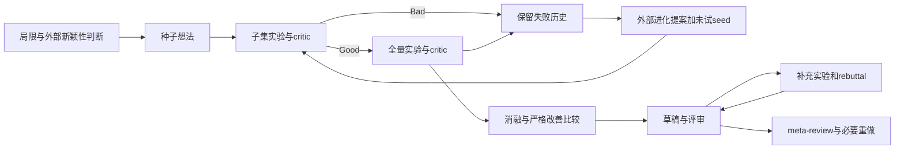
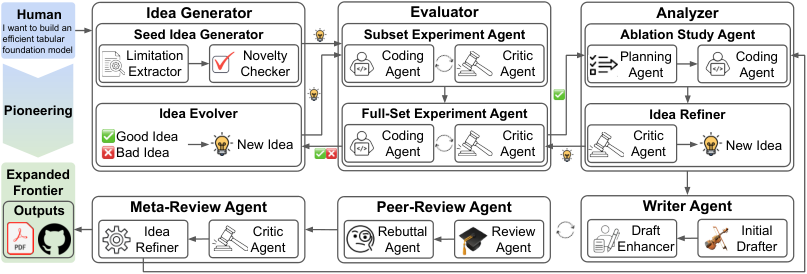

# ScientistTwo：有界实验升阶、消融与评审控制

[English](README-en.md)

> **L1 CPU 控制合同，不是完整自主科学家。** 本地不运行 LLM、编写或执行科研代码、判断新颖性、评价方法有效性或生成论文；所有这些行为都是外部接口。固定回调只验证状态与预算，完整研究实验成本过高，不复现（审查 DONE）。

## 论文信息

| 字段 | 内容 |
| --- | --- |
| 论文链接 | [ScientistTwo: Pioneering the Human Knowledge Frontier with Autonomous AI](https://arxiv.org/abs/2609.19644v1)，[固定 v1 原文](https://arxiv.org/html/2609.19644v1)，[作者项目](https://scientist-two.github.io/) |
| 公司 / 机构 | 一作 Jaehyun Nam，Google Cloud AI Research |
| 首次公开日期 | **2026-09-17 03:37:42 UTC**（arXiv v1）；本轮为历史漏项修复，不是 11/13 新首发 |
| 原作者代码 | 固定 v1 与官方项目页未找到可核实的 ScientistTwo 完整框架源码入口；项目公开生成论文画廊，不能将生成论文／solver 产物或第三方复刻当作框架开源；PaperOrchestra、ScholarPeer 是所用组件，也不等于本系统源码 |
| 本地 adapter / key | `scientist-two`；`adapter=null`；未接入 Evolve |
| 本地复现代码 | `src/auto_research/agent_research/scientist_two.py` |

## 原始论文总结

### 背景与主要改动

ScientistTwo 面向给定科学问题的持续研究：先提炼已有方法局限，再生成并筛选新颖想法；在复现的子集基线上做工程迭代，只有被判为 Good 的想法才升到全量 benchmark。新一轮想法同时利用成功与失败日志，并加入尚未尝试的高新颖度种子，避免只围绕早期赢家局部搜索。

通过全量验证后，系统还执行消融、严格结果比较、论文写作、补充实验式 rebuttal 和 meta-review。结构变简单或审稿意见被回应，并不自动证明方法更好；只有 Result Comparison Agent 确认严格改善才更新 best 并重做后续分析。

### 架构与流程



<!-- paper-figure:start -->
### 原论文关键图

[](https://arxiv.org/html/2609.19644v1/scientisttwo_overview.png)

图片来自[原论文](https://arxiv.org/html/2609.19644v1#S1.F3)，版权归原作者所有。本文件保存官方 HTML 的 Figure 3 PNG 原始字节，未重画、裁剪或渲染；图中各类模型、实验及写作 Agent 并非本地已实现。
<!-- paper-figure:end -->

### 核心公式

第 k 轮候选结合外部提出的进化想法与尚未评估的种子：

$$
\mathcal H_k=\mathcal I_k\cup\mathcal H_0^{(k)},\qquad
\mathbf R_{<k}=\bigcup_{i<k}\mathcal R_i.
$$

历史必须同时保留 Good 与 Bad 的执行证据；Good 是外部语义判断，不是本地固定数值阈值。成功数达到 S 提前停止；预算耗尽且仍无全量 Good 则终止，已有至少一个成功则交外部 Selector 选择，不由本地随意聚合多个指标。

$$
best\leftarrow proposed\quad\text{iff external comparison certifies strict superiority}.
$$

Fig.4 的 `stage` 对 accept 立即返回、reject 立即丢弃、refine 调用外部改进器；最多执行指定次数的 critic。按原文伪代码，即使最后一次给出 refine 也会调用改进器，随后因未被接受而返回 None。**critic 次数与工程修改次数是不同预算单位**，不能把末次未经评价的新产物当成功。

附录 A.2 配置包括局限提取最多 16 轮、每轮一个种子和一个进化想法、探索最多 4 轮或收集 4 个成功、工程修改最多 2 轮、消融修改最多 1 轮、peer-review 最多 2 轮且评分达到 8 提前终止、review-driven idea refinement 最多 1 轮。本地 `review_rebuttal` 明确以 review 调用数计费，只在还剩复审槽时执行 rebuttal，不把超预算的未复审修改接受；它不是完整 meta-review 流水线。

### 论文离线与线上效果

作者在 107 个科研问题上报告 86 个成功产物（80.4%），成功案例相对人类基线平均提升 25.2%。在生成论文上，ScholarPeer 平均评分 7.5/10，Stanford Agentic Reviewer 为 5.7/10。**ScholarPeer 同时参与草稿改进，是 in-distribution 评审；Stanford 评审器由作者作为开发未见的 held-out evaluator**。这些模拟评分不等于真实会议录用，也不证明不同任务和原研究系统的成本完全相同。

论文还报告 33 篇 NeurIPS 来源产物、9 位专家的人类评估；其总体相对偏好约为与人类论文持平，方法严谨性并非所有比较都更优。未报告生产用户流量线上 A/B。本地不运行这些任务，也不把回调通过率与作者科研成功率并排比较。

## 本地复现

### 数据协议与代码映射

| 控制核 | 实际行为与外部责任 |
| --- | --- |
| `run_stage` | 运行 Fig.4 的有界状态与回调次数，保留每次 artifact/critique；不产生 critic 的语义判断 |
| `promote_subset` | 只有 subset Good 调用 full 实验；full Bad/Engineer 仍保留原判定，不因升阶变 Good |
| `build_round` | 向外部 evolver 传递完整 Good/Bad 历史，再加入按外部 novelty 排序的未试种子；不自动生成或评价想法 |
| `search_decision` | 达成成功数、预算耗尽时的选择／继续／无成功终止；只计全量 Good |
| `strict_refinement` | 只接受外部明确“严格优于”的布尔判断，持平或不能证明改善则保留原对象 |
| `review_rebuttal` | 接受外部 1–10 分评审，默认评分≥8或两次 review 预算；不产生评价、补充实验或修改论文 |

传入的是显式结果引用与外部判据，不含 gold 答案或隐藏目标计划。结果引用存在不代表实验真实发生；callback 也不是安全沙箱。上层仍需审计评测协议、train/validation/test 隔离、代码执行与语义判断。相同 idea 的新版本必须保留身份，新的已评估想法 ID 不可重复计作探索成功；相同 novelty 时按 ID 排序是本地确定性约定。

```bash
PYTHONPATH=src python -c 'from auto_research.agent_research.scientist_two import diagnostic; print(diagnostic(42))'
PYTHONPATH=src python -m pytest tests/agent_research/test_scientist_two.py -q
```

### 结果与负控

诊断用明示的固定回调真值表，seed 只扰动种子输入顺序。检查 refine 后再 accept、末次未复审产物丢弃、拒绝后不继续、Engineer 不越过全量门、全量失败不升级、成功与失败历史不丢失、非严格改善保留 best、审稿阈值与次数限制。外部异常与非法类型直接传播／拒绝，不被包装成科研成功。

冻结源码已在 CPU 上实际执行 seed 42／43／44，三组控制检查均通过，见 [控制合同指标](metrics/component-cpu-seeds42-44.json) 与统一冻结运行回执。它只测固定回调合同，不是科研任务成功率，也不是训练耗时。本地明确拒绝 CUDA，不要求 GPU 回执。

## 复现边界

这是 CPU 控制语义，不是可执行的科研 Agent、语义 critic、novelty checker 或实验平台。未实现自动文献检索、代码修复、结果多指标比较、消融设计、LLM 写作、真实 rebuttal 实验或完整 meta-review；没有 Evolve 注册或自动晋级。外部回调返回 Good 或高分也不自动证明主张正确，仍需 ScientistOne 式证据与完整性审计。

### 高成本完整实验

论文总评估为 107 个科研任务。§4.3 在 33 个 NeurIPS 来源问题上做成本分析，作者报告单任务约 2–3 天、均值约 2.5 天，平均 **USD 3765**，包含 token 和虚拟机成本；这是作者环境测量，不是本地单卡测量，也不是全部 107 任务费用的直接总计。

附录用 Gemini 3.6 Flash 与 Claude Code / Opus 4.8，多轮子集／全量 benchmark、消融与补充实验、长上下文写作及评审构成多日任务。对单张 A100/A30 或本地 Mac 的本轮预算，**成本过高，不复现（审查 DONE）**。未调用 LLM API、运行科研实验或探针，未下载 checkpoint、完整 25 MB PDF 或生成论文包；不进入自动重试或实现队列。
