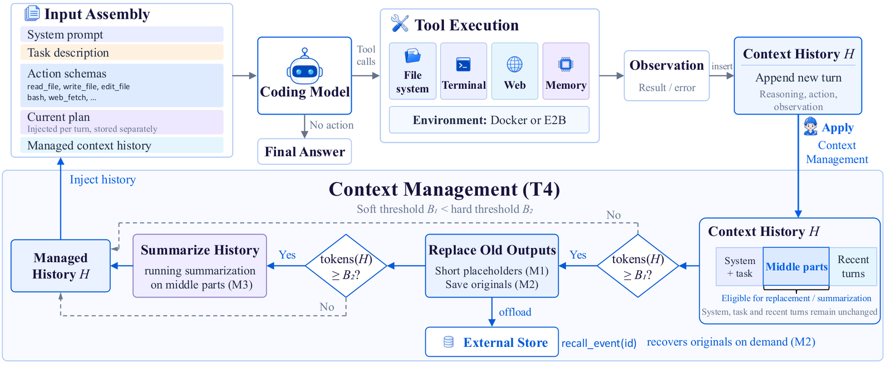

<!-- source-sha256: 483c491b2466840aad3a42570b02158a0b96a0b93e0aef484999546b50d8110f -->

[简体中文](README.md) · English

# An Empirical Study of Harness Design for Coding Agents

> **L1 core mechanism diagnostic.** The local implementation controls harness factors. The mini-suite is not a SWE-bench or Terminal-Bench result.

## Paper information

| Field | Details |
|---|---|
| Paper | [An Empirical Study of Harness Design for Coding Agents](https://arxiv.org/abs/2609.20804) |
| Institution | University of Massachusetts Amherst (first author affiliation) |
| First public release | 2026-09-17 (arXiv v1) |
| Original source code | No public author implementation found as of 2026-09-19. |
| Adapter/method | `harness-design-study` |
| Local reproduction code | [`src/auto_research/agent_research/latest_20260919.py`](https://github.com/daiwk/auto-research/blob/main/src/auto_research/agent_research/latest_20260919.py) |

## Original paper summary

### Background and main changes

Hold the execution loop fixed and vary planning, action space and context management independently to isolate which coding-agent harness factors affect outcomes and costs.

<!-- paper-figure:start -->
### Key figure from the paper

> **Figure 2:** Overall design and components. From the [paper](https://arxiv.org/abs/2609.20804); copyright belongs to the authors. Click for the source.
<!-- paper-figure:end -->

### Core mechanism

The local reference kernel retains defining gates, weights, state transitions or scheduling rules and writes intermediates to the metrics artifact. See implementation functions and test invariants for variables and formulas.

### Offline and online results

Paper deployment, benchmark, training-efficiency and inference-speed scores are author results only. The [local three-seed artifact](metrics/mechanism-seeds42-44.json) verifies mechanisms, shapes and state invariants, not paper-level scores.

## Scope

Harness factors are controllable locally. The mini-suite is not a SWE-bench or Terminal-Bench evaluation.
