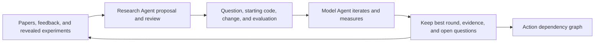
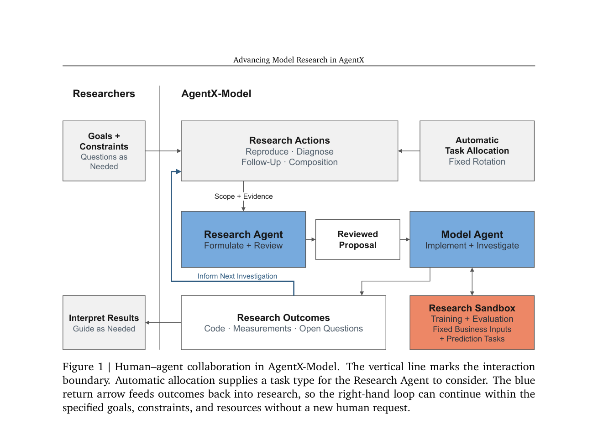

# AgentX-Model: Use experiment results to drive ongoing model research

<!-- source-sha256: 08d2c398ff19e1fbd9cb60afd67f9454809b2a4a167da8bd7d422aae7d9c3ee0 -->

[简体中文](README.md)

> Public-data concept demo: deterministic roles and a result-blind dependency replay over six genuinely trained MovieLens-1M model nodes. Not the private 473-node graph, LLM agents, or online A/B.

## Paper information

| Field | Details |
|---|---|
| Paper | [arXiv 2609.30001](https://arxiv.org/abs/2609.30001) |
| Institution | Kuaishou (paper copyright attribution; first author Shuang Yang). |
| First public release | 2026-09-24 (arXiv v1) |
| Author code | No public AgentX-Model implementation, production code, experimental graph, or logs found as of 2026-09-28. |
| Local adapter or method key | `agentx-model-replay`, independent public evaluation; not a generic `agent-eval` method or Evolve operator. |
| Local reproduction code | [`agentx_model.py`](https://github.com/daiwk/auto-research/blob/main/src/auto_research/agent_research/agentx_model.py), [`agentx_model_public.py`](https://github.com/daiwk/auto-research/blob/main/src/auto_research/agent_research/agentx_model_public.py) |

## Paper method and evidence

Rather than a single loop from idea to evaluation, AgentX-Model studies how to choose the next experiment. A Research Agent combines papers and known experiment paths, proposes and independently reviews changes. A Model Agent iteratively edits, trains, and measures a fixed business prediction task, returning the best intermediate implementation, negative results, and unresolved questions. The roles exchange proposals, not full work logs.

<!-- paper-figure:start -->
### Original paper figure

Figure 1 shows the two roles and research loop. From the [original paper](https://arxiv.org/abs/2609.30001); copyright remains with the authors.
<!-- paper-figure:end -->

### Core equation

A proposal $P_t=(q_t,s_t,\delta_t,v_t)$ specifies question, starting implementation, change, and evaluation. Research state $S_t=(\mathcal I_t,\mathcal E_t,\mathcal Q_t)$ holds implementations, conditional evidence, and unresolved questions. Best valid AUC is $b_i=\max_{r\in\mathcal V_i}\operatorname{AUC}_{i,r}$. Compare against both the parent and best comparable ancestor; recovery from a bad parent is not a new path best.

Reproduce adds a paper method; Follow-up extends a result; Composition resolves conflicts before testing complementarity; Diagnose uses observation and intervention, not immediate AUC. Replay requires parents to be selected first and hides candidate results until selection.

### Reported results

In about 25 days the paper reports 636 experiments, 560 above corresponding business-baseline AUC. Five recent production A/B tests include acquisition-efficiency, target-audience advertising spend, and watch-time improvements. The authors compare task allocation across six environments and 473 private nodes, with no uniformly best complex strategy.

## Local reproduction

1. For each MovieLens-1M user, retain the last two time-ordered interactions for validation/test. Use at most 18,000 training records, fit statistics on train only, and use leave-one-out user/item rating-rate features.
2. Predict rating ≥ 4 with a fixed logistic-regression budget. Reproduce candidates add user×item rating-rate interaction or history-genre matching; Follow-up adds second-order interaction; Composition joins features; Diagnose fits calibration on train and checks validation PCOC.
3. Research sees actions, dependencies, changes, and revealed parent results only. Review rejects baseline, split, or starting-reference changes. Model receives recorded 40/80-step trajectories only after legal selection; retain best and final rounds.
4. Fixed rotation, uniform random, and revealed-parent greedy each get two picks from five AUC candidates. Diagnose runs outside AUC routing. Selection uses public rules, not an LLM.
5. Choose champions on validation only; compute their test AUC afterward. There is no future-node oracle or online traffic.

~~~bash
python scripts/run_agentx_model_public.py \
  --dataset-dir data --seeds 42,43,44 --budget 2 \
  --output runs/agentx-model/public-replay.json
~~~

[Three-seed MovieLens receipt](metrics/movielens-1m-replay-seeds42-44.json).

| Seed | Baseline validation AUC | Fixed / random / greedy best validation AUC | Corresponding test AUC | Diagnostic PCOC before → after |
|---:|---:|---:|---:|---:|
| 42 | 0.71415 | 0.71415 / 0.71458 / 0.71458 | 0.70729 / 0.70524 / 0.70524 | 1.0173 → 0.9941 |
| 43 | 0.71648 | 0.71648 / 0.71648 / 0.71648 | 0.66524 / 0.66524 / 0.66524 | 1.0500 → 1.0242 |
| 44 | 0.72085 | 0.72290 / 0.72219 / 0.72219 | 0.72188 / 0.72229 / 0.72229 | 1.0435 → 1.0220 |

Two picks produce different paths, but three seeds and one preset graph do not rank allocation strategies. All seed-44 strategies exceed baseline +0.001, fixed at pick 1 and others at pick 2. Test does not influence selection; closer-to-one PCOC does not imply online calibration benefit. Deterministic roles are not Pi/Claude Code/GLM, independent LLM review, or autonomous coding; candidates are preset. Rating is not industrial exposure, click, or conversion. This verifies orchestration and replay, not productivity, gain, or Evolve integration.
