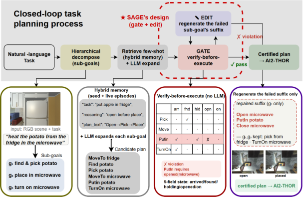

# SAGE: Symbolic Action-Gating and Editing for LLM Task Planners

<!-- source-sha256: c6f16d573251b40ae80acd55d01ab2dbf2ec1b53798f1fe659a014fd8054b7eb -->

[简体中文](README.md)

> **L1 core-mechanism diagnostic.** Runs a zero-token symbolic gate and local suffix editing, not AI2-THOR.

## Paper information

| Field | Details |
|---|---|
| Paper | [SAGE: Symbolic Action-Gating and Editing for LLM Task Planners](https://arxiv.org/abs/2609.34268) |
| Organization | No first-author affiliation is listed on the paper's first page. |
| First public release | 2026-09-28 (arXiv v1) |
| Authors' code | [mtbui2010/sage](https://github.com/mtbui2010/sage) is public. |
| Adapter / method | `sage-planner` |
| Local reproduction code | [`src/auto_research/agent_research/latest_20260930_closure.py`](https://github.com/daiwk/auto-research/blob/main/src/auto_research/agent_research/latest_20260930_closure.py) |

## Original paper

### Motivation and method

A symbolic precondition gate blocks unsafe actions before execution and returns a typed reason. On failure, rewrite only the suffix for the relevant subgoal and retain the completed prefix.

~~~mermaid
flowchart LR
  I[Public input and current state] --> M[sage-planner mechanism]
  M --> A[Auditable intermediates]
  A --> O[Output or state update]
~~~

<!-- paper-figure:start -->
### Key figure from the paper

> **Figure 2:** Overall workflow, key stages, and data flow. From the [original paper](https://arxiv.org/abs/2609.34268); copyright remains with the authors. Click the image for the source.
<!-- paper-figure:end -->

### Core computation

The reference kernel retains the paper's decisive gates, masks, recursion, credit weights, or promotion conditions. Tests also check gradient isolation, type boundaries, and determinism.

### Paper results

Benchmarks, speed, and training curves belong to the paper. The local three-seed mini-suite checks mechanisms and invariants, not paper-scale results or online gains.

## Local reproduction

See the [three-seed diagnostic](metrics/mechanism-seeds42-44.json), marked `diagnostic_only=true` and ineligible for formal capability ranking.

## Reproduction boundaries

The zero-token symbolic gate and local suffix editor run. AI2-THOR was not run.
