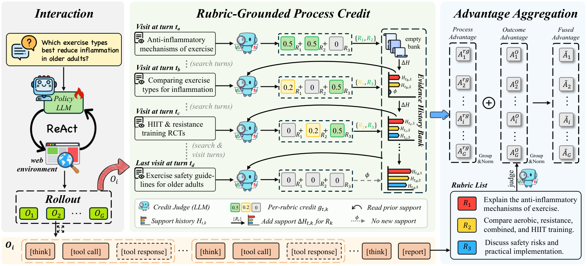

<!-- source-sha256: 57f0b8ad6d5f218d33ee5f2133d0e88ce5f6c3aef61fdca7f4167d8a74d9a2f0 -->

[简体中文](README.md) · English

# Dr.Credit: Rubric-Grounded Process Credit Assignment for Deep Research Agents

> **L1 core mechanism diagnostic.** Incremental rubric support is computed against history. Rubrics and evidence scores are fixtures; no gold answer is read.

## Paper information

| Field | Details |
|---|---|
| Paper | [Dr.Credit: Rubric-Grounded Process Credit Assignment for Deep Research Agents](https://arxiv.org/abs/2609.34296) |
| Institution | University of Chinese Academy of Sciences (first author affiliation) |
| First public release | 2026-09-28 (arXiv v1) |
| Original source code | No public author repository found as of 2026-09-30. |
| Adapter/method | `dr-credit` |
| Local reproduction code | [`src/auto_research/agent_research/latest_20260930_closure.py`](https://github.com/daiwk/auto-research/blob/main/src/auto_research/agent_research/latest_20260930_closure.py) |

## Original paper summary

### Background and main changes

Compare a tool result with previously accepted support for each rubric and credit only new or partial support. Combine it with outcome advantage so repeated evidence does not earn repeated credit.

<!-- paper-figure:start -->
### Key figure from the paper

> **Figure 2:** Core architecture, modules and connections. From the [paper](https://arxiv.org/abs/2609.34296); copyright belongs to the authors. Click for the source.
<!-- paper-figure:end -->

### Core mechanism

The local reference kernel retains the defining gates, masks, recursion, credit weights or promotion criteria. Tests check gradient isolation, type boundaries and determinism.

### Offline and online results

Paper benchmarks, speeds and training curves are author results only. The local three-seed mini-suite checks mechanisms and invariants, not paper-scale performance or online gains.

## Local reproduction

See [three-seed diagnostics](metrics/mechanism-seeds42-44.json). `diagnostic_only=true` excludes these results from formal capability rankings.

## Scope

The implementation computes incremental support against rubric history using fixture rubrics and evidence scores. It never reads the gold answer.
