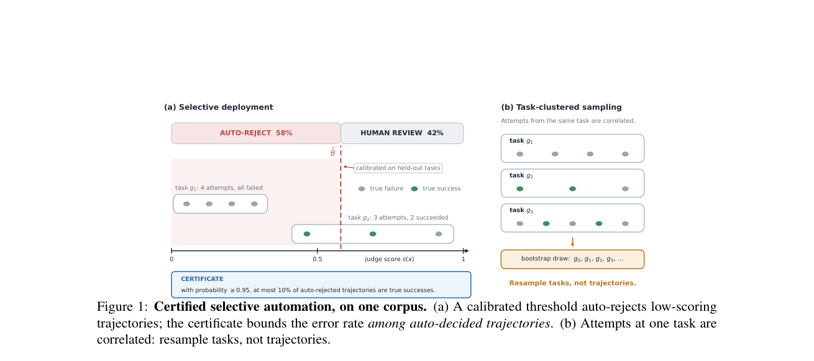

# Certified Selective Automation of LLM Agent Evaluation

<!-- source-sha256: 4c92b23970fc4ef39d114d11c69df0fe8556fb651ed38e70b25c9b67084eb89f -->

[简体中文](README.md)

> **L1 core-mechanism diagnostic.** Runs a task-cluster bootstrap certificate. Mini-suite certification does not establish coverage on the paper's corpus.

## Paper information

| Field | Details |
|---|---|
| Paper | [Certified Selective Automation of LLM Agent Evaluation](https://arxiv.org/abs/2609.34320) |
| Organization | First-author affiliation: independent researcher |
| First public release | 2026-09-28 (arXiv v1) |
| Authors' code | No public author repository was found as of 2026-09-30. |
| Adapter / method | `certified-selective-eval` |
| Local reproduction code | [`src/auto_research/agent_research/latest_20260930_closure.py`](https://github.com/daiwk/auto-research/blob/main/src/auto_research/agent_research/latest_20260930_closure.py) |

## Original paper

### Motivation and method

Bootstrap by task cluster rather than assuming trajectories are independent. Form an upper confidence bound on error within the automated region and take over automatically only when the certificate falls below budget.

~~~mermaid
flowchart LR
  I[Public input and current state] --> M[certified-selective-eval mechanism]
  M --> A[Auditable intermediates]
  A --> O[Output or state update]
~~~

<!-- paper-figure:start -->
### Key figure from the paper

> **Figure 1:** Overview of the paper's method and its key components. From the [original paper](https://arxiv.org/abs/2609.34320); copyright remains with the authors. Click the image for the source.
<!-- paper-figure:end -->

### Core computation

The reference kernel retains the paper's decisive gates, masks, recursion, credit weights, or promotion conditions. Tests also check gradient isolation, type boundaries, and determinism.

### Paper results

Benchmarks, speed, and training curves belong to the paper. The local three-seed mini-suite checks mechanisms and invariants, not paper-scale results or online gains.

## Local reproduction

See the [three-seed diagnostic](metrics/mechanism-seeds42-44.json), marked `diagnostic_only=true` and ineligible for formal capability ranking.

## Reproduction boundaries

The task-cluster bootstrap certificate runs. The mini-suite certificate does not measure coverage on the paper's corpus.
