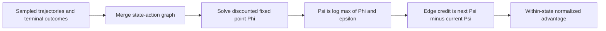
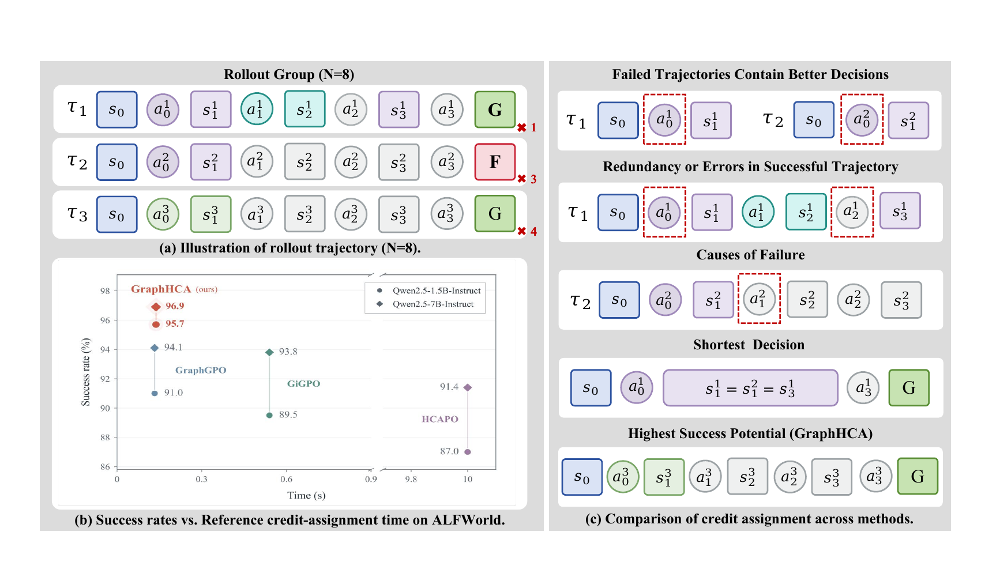

<!-- source-sha256: 6f61ccf38c84d0b8cd2393f0b4b8df1151a1984a56448307390ff8128d32cc20 -->

[简体中文](README.md) · English

# GraphHCA: Closed-form hindsight credit assignment for long-horizon agents

> **L1 core mechanism without gold access.** Fixed-point potentials and step advantages are computed from a sampled trajectory graph, actions and terminal outcomes, with no reference answers or plans.

## Paper information

| Field | Details |
|---|---|
| Paper | [GraphHCA: Closed-Form Hindsight Credit Assignment for Long-Horizon LLM Agents](https://arxiv.org/abs/2609.35084) |
| Institutions | Beihang University / Zhongguancun Academy (first author affiliations) |
| First public release | 2026-09-28 (arXiv v1) |
| Original source code | No author code found or released as of 2026-09-30. |
| Local adapter/method | `graphhca` |
| Local reproduction code | [`src/auto_research/agent_research/latest_20260930.py`](https://github.com/daiwk/auto-research/blob/main/src/auto_research/agent_research/latest_20260930.py) |

## Original paper summary

### Background and main changes

Sparse terminal rewards do not identify critical actions in long trajectories. GraphHCA merges rollouts into a state-transition graph and solves a discounted fixed point with success/failure terminal boundaries. Differences in log potential give step credit, normalized among actions from the same state.

<!-- paper-figure:start -->
### Key figure from the paper

> **Paper method figure:** Trajectory-graph construction and hindsight credit propagation. From the [paper](https://arxiv.org/abs/2609.35084); copyright belongs to the authors.
<!-- paper-figure:end -->

### Core equations

Nonterminal states satisfy $\Phi(s)=\gamma\,\mathbb E_{a\sim\hat q}[\Phi(s')]$. Success and failure terminals are fixed to 1 and 0. Potential is $\Psi(s)=\log\max(\Phi(s),\epsilon)$; step credit $\Psi(s')-\Psi(s)$ is normalized across actions sharing the start state.

### Offline and online results

Reported long-horizon agent scores are paper results only. Local checks cover fixed-point convergence, credit ordering for successful edges and inaccessibility of gold fields. See [`metrics/mechanism-seeds42-44.json`](metrics/mechanism-seeds42-44.json).

## Local reproduction

`graphhca_credit` accepts only `Transition` and Boolean success. See the [aggregate diagnostic](../../experiments/sep30-p0-p1-mechanisms-seeds42-44.json).

## Scope

No language model was trained and GraphHCA is not registered as an Evolve operator. Integration requires the unified controller to sample real trajectories, execute the estimator and verify policy updates on isolated validation.
