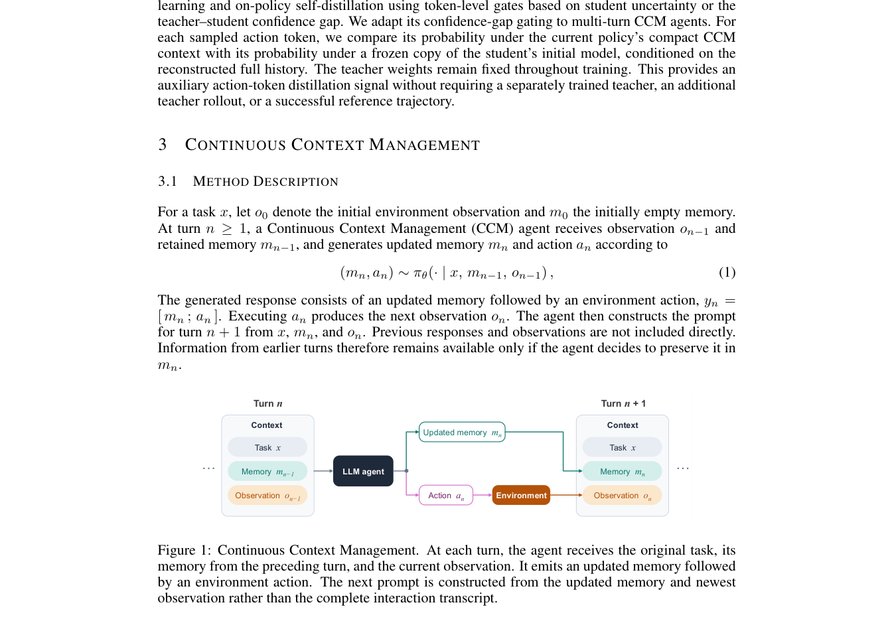

# Continuous Context Management

<!-- source-sha256: 80b51ef9aa0c30f0c405b1337f4eb455f918bab304c1abfe82c473d10fa9c2e3 -->

[简体中文](README.md)

> **L1 core-mechanism diagnostic.** Executes a per-turn bounded-context contract without running TerminalBench or a WebShop checkpoint.

## Paper information

| Field | Details |
|---|---|
| Paper | [Continuous Context Management](https://arxiv.org/abs/2609.35540) |
| Organization | First-author affiliation: University of Miami |
| First public release | 2026-09-28 (arXiv v1) |
| Authors' code | No public author repository was found as of 2026-09-30. |
| Adapter / method | `ccm` |
| Local reproduction code | [`src/auto_research/agent_research/latest_20260930_closure.py`](https://github.com/daiwk/auto-research/blob/main/src/auto_research/agent_research/latest_20260930_closure.py) |

## Original paper

### Motivation and method

Each turn emits an action and updated bounded memory. The next turn receives only the original task, memory, and latest observation. Full history is used only during training for privileged distillation.

~~~mermaid
flowchart LR
  I[Public input and current state] --> M[ccm mechanism]
  M --> A[Auditable intermediates]
  A --> O[Output or state update]
~~~

<!-- paper-figure:start -->
### Key figure from the paper

> **Figure 1:** Overview of the paper's method and its key components. From the [original paper](https://arxiv.org/abs/2609.35540); copyright remains with the authors. Click the image for the source.
<!-- paper-figure:end -->

### Core computation

The reference kernel retains the paper's decisive gates, masks, recursion, credit weights, or promotion conditions. Tests also check gradient isolation, type boundaries, and determinism.

### Paper results

Benchmarks, speed, and training curves belong to the paper. The local three-seed mini-suite checks mechanisms and invariants, not paper-scale results or online gains.

## Local reproduction

See the [three-seed diagnostic](metrics/mechanism-seeds42-44.json), marked `diagnostic_only=true` and ineligible for formal capability ranking.

## Reproduction boundaries

The per-turn bounded-context contract runs locally. No TerminalBench or WebShop checkpoint was run.
