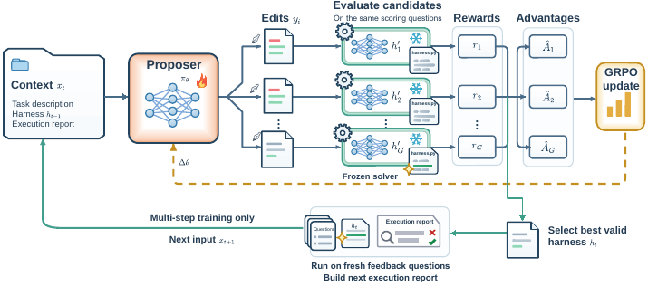

# Harness Learning: Executable Scaffolds for Test-Time Adaptation

<!-- source-sha256: 218f43e9fe5ba8148425f610a156bfd8b37796963e220058d8f56bbd3273b8f9 -->

[简体中文](README.md)

> **L1 mechanism diagnostic without gold.** Execution feedback drives multi-round harness revisions with a frozen task policy.

## Paper information

| Field | Value |
| --- | --- |
| Paper | [Harness Learning Enables Generalizable Test-Time Adaptation](https://arxiv.org/abs/2609.35738) |
| Affiliations | Johns Hopkins University / Carnegie Mellon University |
| First public release | 2026-09-28 (arXiv v1) |
| Authors' code | No public author code found as of 2026-09-30. |
| Adapter / method | `harness-learning` |
| Local code | [`src/auto_research/agent_research/latest_20260930.py`](https://github.com/daiwk/auto-research/blob/main/src/auto_research/agent_research/latest_20260930.py) |

## Original paper

### Background and contribution

Adapt the executable harness rather than weights at test time. A proposer uses actual execution feedback to revise validation, interpretation, retrieval, or retries. The task model remains frozen and the loop retains better scaffolds after several rounds.

<!-- paper-figure:start -->
### Key figure from the paper

Original overview of the proposer, executor, and revision loop. From the [paper](https://arxiv.org/abs/2609.35738); copyright belongs to the authors. Not a local result.
<!-- paper-figure:end -->

### Core mechanism

The categorical proposer uses group-centered $A_i=r_i-\bar r$ and REINFORCE on revision logits. Inputs are execution-report score and failure type, never gold answers, plans, or hidden verifier fields.

### Paper results

The paper's cross-task generalization is not a local result. Local tests check multi-round revision, execution feedback, and gold isolation.

## Local reproduction

`HarnessProposer` and `adapt_harness` accept a real external execution callback. See [three-seed diagnostics](metrics/mechanism-seeds42-44.json) and [aggregate results](../../experiments/sep30-p0-p1-mechanisms-seeds42-44.json).

## Reproduction limits

No general Agent runner or Evolve integration: those paths cannot yet safely execute arbitrary harnesses and validate them in isolation. Rule-based mini-suite success is not capability gain.
