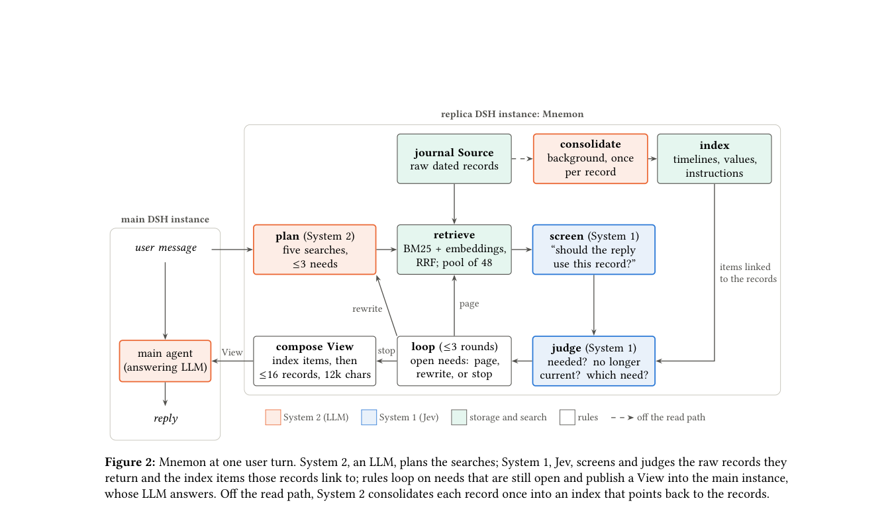

# Mnemon: Raw Records, Fast Judgments, Slow Thoughts

<!-- source-sha256: a3a9e7ab74b78aabf57f675149ac77a61bf8885ea999e26004fbb6656677cad7 -->

[简体中文](README.md)

> L1 raw-record retrieval and bounded views only; no Jev checkpoint or local LoCoMo score.

## Paper information

| Field | Details |
|---|---|
| Paper | [Mnemon: Raw Records, Fast Judgments, Slow Thoughts](https://arxiv.org/abs/2609.36059) |
| Institution | The paper does not list an affiliation for the first author. |
| First public release | 2026-09-28 (arXiv v1) |
| Author code | No public author repository found as of 2026-09-30. |
| Local adapter or method key | `mnemon` |
| Local reproduction code | [`src/auto_research/agent_research/latest_20260930_closure.py`](https://github.com/daiwk/auto-research/blob/main/src/auto_research/agent_research/latest_20260930_closure.py) |

## Paper method and evidence

Retain dated raw records. A slower planner proposes searches, a fast Jev decides which records matter, and a compact view under a fixed budget feeds the original answering model.

<!-- paper-figure:start -->
### Original paper figure

Figure 2 illustrates the original workflow. From the [original paper](https://arxiv.org/abs/2609.36059); copyright remains with the authors.
<!-- paper-figure:end -->

### Core equation

The reference preserves record selection and gating; tests cover type boundaries, determinism, and isolation.

### Reported results

The paper's benchmarks, speed and learning curves are not measured by the local mini-suite.

## Local reproduction

The [three-seed reference tests](metrics/mechanism-seeds42-44.json) check the operator, shapes, boundaries, and state invariants under a fixed fixture budget. These are `diagnostic_only=true`, not paper-scale outcomes or online gains.
