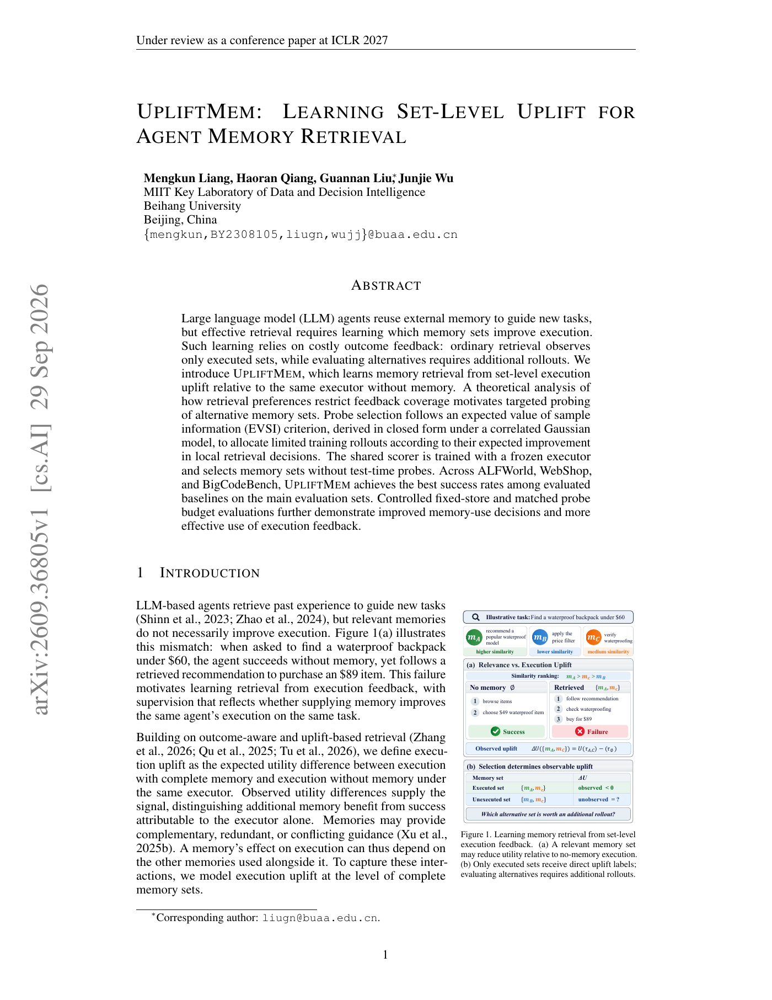

# UpliftMem: Learn agent memory retrieval from set-level execution gains

<!-- source-sha256: 893cea407913d7af077dae5b4d5dfe27ca3255c8604d41656d47deccd277d752 -->

[简体中文](README.md)

> L1 paired uplift and Gaussian EVSI probe selection.

## Paper information

| Field | Details |
|---|---|
| Paper | [arXiv v1](https://arxiv.org/abs/2609.36805) |
| Institution | Beihang University. |
| First public release | 2026-09-29 (arXiv v1) |
| Author code | No author repository found as of 2026-09-30. |
| Local adapter or method key | `upliftmem` |
| Local reproduction code | `src/auto_research/agent_research/latest_20260930_followup.py` |

## Paper method and evidence

Relevant memories can still hurt execution. With one frozen executor, use the outcome difference between the entire retrieved set and no memory as supervision. Learn complementarity, redundancy, and conflict at set level. When exhaustive rollouts are impractical, use expected value of sample information (EVSI) under a correlated Gaussian posterior to probe the sets most likely to change the local retrieval decision.

<!-- paper-figure:start -->
### Original paper figure

Figure 1 shows that related memories may have negative uplift and that unexecuted sets have missing feedback. From the [original paper](https://arxiv.org/abs/2609.36805); copyright remains with the authors.
<!-- paper-figure:end -->

## Local reproduction

`set_level_uplift` enforces paired treatment/control, and `gaussian_evsi` selects a probe under a fixed posterior. See the [three-seed mechanism results](metrics/mechanism-seeds42-44.json). No complete set constructor, shared scorer, or ALFWorld/WebShop/BigCodeBench executor; this is mechanism and evaluation infrastructure.
