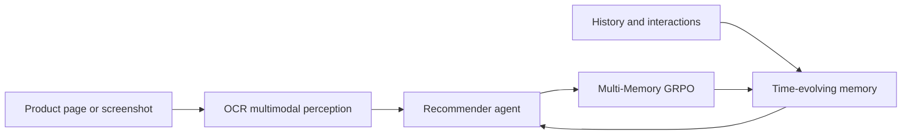
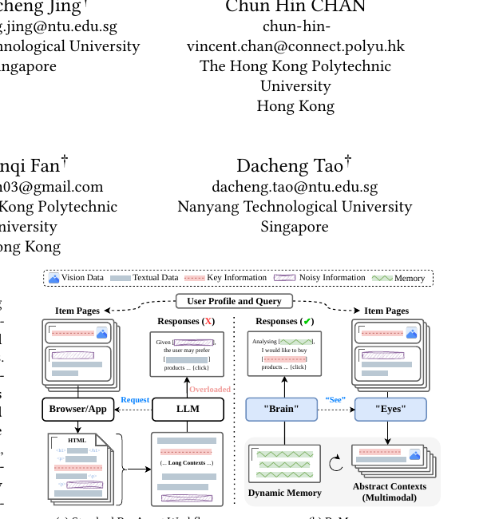

<!-- source-sha256: d5d8f7279a3edb78a21d8194675f1ee236ced8e0b6fb890d61cc24b0a81d1813 -->

[简体中文](README.md) · English

# ReMem: Multimodal perception and evolving memory for recommender agents

> **L1 memory mechanism.** Time-evolving memory with a fixed budget and a multi-memory GRPO objective are implemented. No real shopping pages or OCR model are connected.

## Paper information

| Field | Details |
|---|---|
| Paper | [ReMem](https://arxiv.org/abs/2609.37311) |
| Institution | The Hong Kong Polytechnic University (first author affiliation) |
| First public release | 2026-09-29 (arXiv v1) |
| Original source code | Yes: [Quhaoh233/ReMem](https://github.com/Quhaoh233/ReMem) |
| Local adapter/method | `remem` |
| Local reproduction code | [`src/auto_research/agent_research/latest_20260930.py`](https://github.com/daiwk/auto-research/blob/main/src/auto_research/agent_research/latest_20260930.py) |

## Original paper summary

### Background and main changes

Recommender agents must extract information from heterogeneous product pages without adding unlimited user history to the context. ReMem uses OCR-driven multimodal item perception for compact semantic representations, then keeps preferences in dynamic memory with a fixed budget. Multi-Memory GRPO shares policy updates across memory views.

<!-- paper-figure:start -->
### Key figure from the paper

> Figure 1: The roles of multimodal “eyes” and a dynamic-memory “brain.” From the [paper](https://arxiv.org/abs/2609.37311); copyright belongs to the authors.
<!-- paper-figure:end -->

### Core mechanism

Local memory keeps recent observations and chooses historical blocks by decayed relevance/recency, with $|M_t|\le B$. The objective computes group-normalized advantages separately for each memory view of the same query, then applies a shared clipped policy objective.

### Offline and online results

The paper reports accuracy and token-efficiency gains for long-context recommender agents. Local checks only cover memory budget, temporal updates, the objective and gold isolation. See [metrics](metrics/mechanism-seeds42-44.json).

## Local reproduction and limits

This is not a complete web agent. No OCR, browser, author data or real episodes ran. Small fixed inputs check information flow, not recommendation capability gains.
