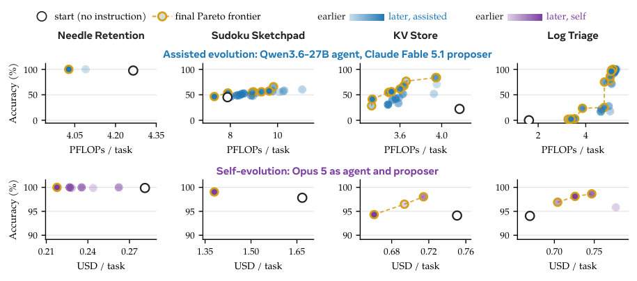

<!-- source-sha256: 4fdb600ba4bc01a4cfdaaed3c13f39fdfbadb2d89a1c8e6c5a7e7dc16d5cf6ab -->

[简体中文](README.md) · English

# Context Language Models

> **L1 core mechanism diagnostic.** Context-file editing and suffix cache boundaries run; Qwen3.5-9B was not trained and no 24-hour agent swarm ran.

## Paper information

| Field | Details |
|---|---|
| Paper | [arXiv 2609.37725](https://arxiv.org/abs/2609.37725) |
| Institutions | University of Washington / Meta Superintelligence Labs (first author affiliations) |
| First public release | 2026-09-29 (arXiv v1) |
| Original source code | Yes: [facebookresearch/context-language-models](https://github.com/facebookresearch/context-language-models) |
| Adapter | `context-lm` |
| Local reproduction code | [`src/auto_research/agent_research/latest_20261001.py`](https://github.com/daiwk/auto-research/blob/main/src/auto_research/agent_research/latest_20261001.py) |

## Original paper summary

### Background and main changes

Treat context as a file the model can edit directly, letting it retain, delete or reorganize information instead of following a fixed external harness policy. Multiple agents maintain separate context files, and the server prefills from the first mismatching token.

<!-- paper-figure:start -->
### Key figure from the paper

> **Figure 28:** Training flow and key optimizations. From the [paper](https://arxiv.org/abs/2609.37725); copyright belongs to the authors. Click for the source.
<!-- paper-figure:end -->

### Core equations

$c_{t+1}=f_\theta^{CLM}(c_t)$. Locally, replace/append file transforms enforce explicit capacity and reuse cache only up to the first prefix mismatch, recomputing the suffix.

### Offline and online results

BrowseComp-Plus accuracy improved 11.4% with 21.5% fewer FLOPs; EdgeBench score improved 5% with 59% fewer FLOPs. Online RL improved Qwen3.5-9B by 47.6% with 12% fewer FLOPs.

## Local reproduction

> **Comparison protocol:** Disabled or default mechanism versus enabled core operator. Only invariants and state transitions are checked; cross-model relative change is not applicable.

See [`metrics/mechanism-seeds42-44.json`](metrics/mechanism-seeds42-44.json) for the three-seed diagnostic. `diagnostic_only=true` means executable state transitions, gradients or scheduling invariants, not formal capability ranking.

## Scope

Context-file edits and suffix cache boundaries execute. No Qwen3.5-9B training or 24-hour agent swarm.
