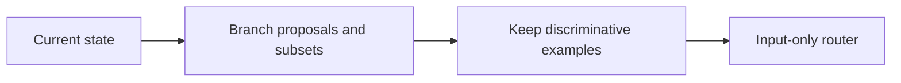
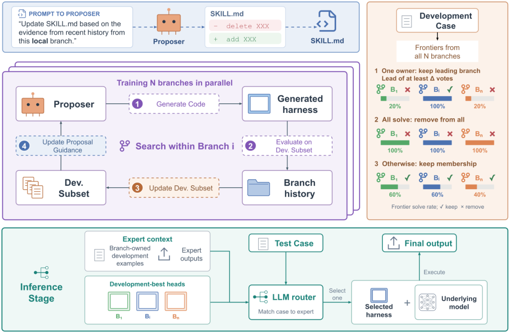

# Mixture of Self-Improving Branches for Agent Harness Optimization

<!-- source-sha256: 9ff8da85697148392d76e9ba8301b0e6aee0b59036dafe81260a42a2c8f27736 -->

[简体中文](README.md)

> **L1 mechanism diagnostic.** Branch subset differentiation and input routing, no LLM-generated harness or SWE-bench run.

## Paper information

| Field | Value |
| --- | --- |
| Paper | [arXiv 2609.37834](https://arxiv.org/abs/2609.37834) |
| Affiliations | No first-author affiliation listed on the paper's first page |
| First public release | 2026-09-29 (arXiv v1) |
| Authors' code | No public author repository found as of 2026-10-01. |
| Adapter / method | `branch-mixture` |
| Local code | [`src/auto_research/agent_research/latest_20261001.py`](https://github.com/daiwk/auto-research/blob/main/src/auto_research/agent_research/latest_20261001.py) |

## Original paper

### Background and contribution

Maintain separate development subsets and proposal policies. Remove examples every branch solves and retain examples that distinguish branches. At deployment an input-only router selects a development-set champion.

<!-- paper-figure:start -->
### Key figure from the paper

Original Figure 1: branching harness optimization. From the [paper](https://arxiv.org/abs/2609.37834); copyright belongs to the authors. Not a local result.
<!-- paper-figure:end -->

### Core mechanism

$J_b^t(H)=|X_b^t|^{-1}\sum_x\mathbb E[r(f_M(H,x),x)]$. The local update retains discriminative examples; the linear router cannot read test labels.

### Paper results

Reported relative gains over Meta-Harness: 34.8% olympiad reasoning, 11.6% Terminal-Bench 2.0, 3.8% SWE-bench Lite.

## Local reproduction

Compare disabled/default against enabled. [Three-seed diagnostics](metrics/mechanism-seeds42-44.json) are `diagnostic_only=true`, not cross-model effects.

## Reproduction limits

Branch subset diversification and routing, without LLM harness generation or SWE-bench.
