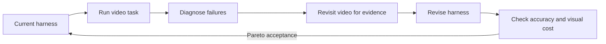
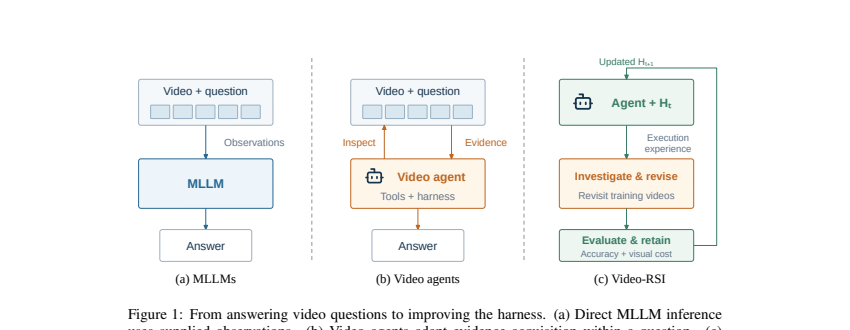

# Video-RSI: Recursively improve video agents through harness evolution

<!-- source-sha256: 8756a87be960f72b7135f1f28eaeac42a03888e2c1ed845216f9ae9d14d1365a -->

[简体中文](README.md)

> L1 acceptance rule, not automatic end-to-end video harness evolution.

## Paper information

| Field | Details |
|---|---|
| Paper | [Video-RSI](https://arxiv.org/abs/2609.37950) |
| Institution | Tsinghua University (first author). |
| First public release | 2026-09-29 (arXiv v1) |
| Author code | [bingjunluo/Video-RSI](https://github.com/bingjunluo/Video-RSI). |
| Local adapter or method key | `video-rsi` |
| Local reproduction code | [`src/auto_research/agent_research/latest_20260930.py`](https://github.com/daiwk/auto-research/blob/main/src/auto_research/agent_research/latest_20260930.py) |

## Paper method and evidence

Existing traces contain only observations selected by the current harness, so alternative failure explanations can remain indistinguishable. Revisit training videos to collect additional evidence, test diagnoses and revise the harness. Accept only a Pareto improvement in accuracy or visual cost.

<!-- paper-figure:start -->
### Original paper figure

Figure 1 contrasts direct answers, a fixed agent and recursive harness improvement. From the [original paper](https://arxiv.org/abs/2609.37950); copyright remains with the authors.
<!-- paper-figure:end -->

### Core equation

Accept when $a'\ge a-\epsilon_a$ and $c'\le c+\epsilon_c$ and at least one dimension strictly improves. A weighted scalar must not hide material regression.

### Reported results

The paper reports improved video understanding accuracy with fewer processed frames. No local benchmark replication.

## Local reproduction

[Three-seed acceptance diagnostic](metrics/mechanism-seeds42-44.json). Candidate harnesses do not see private training answers or example-level scores. No real video decode, code-edit sandbox, generation stopping rule, or executable Evolve operator.
