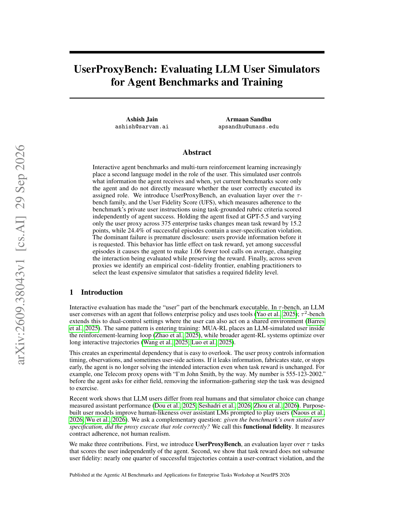

# UserProxyBench: independently auditing the user simulators in agent benchmarks

<!-- source-sha256: d415873cbb379260c87b230a4bb250b67bed3f628ff32b671bb68e71b2ceb4b3 -->

[简体中文](README.md)

> **L1 evaluation mechanism.** Implements strict User Fidelity Score and a premature-disclosure audit without running closed-source proxies.

## Paper information

| Field | Details |
|---|---|
| Paper | [arXiv v1](https://arxiv.org/abs/2609.38043) |
| Organization | The paper does not list an affiliation. |
| First public release | 2026-09-29 (arXiv v1) |
| Authors' code | No author repository was found as of 2026-09-30. |
| Adapter | `user-proxy-bench` |
| Local reproduction code | `src/auto_research/agent_research/latest_20260930_followup.py` |

### Motivation and method

UFS is independent of agent task reward. An episode scores 1 only when every applicable user-contract criterion passes. The audit focuses on premature disclosure, when the simulated user reveals private fields before the agent requests them. That can leave task success unchanged while letting agents skip the information gathering the benchmark is intended to test.

<!-- paper-figure:start -->
### Key figure from the paper

> **First-page overview:** Separates agent reward from user fidelity. From the [original paper](https://arxiv.org/abs/2609.38043); copyright remains with the authors.
<!-- paper-figure:end -->

## Local reproduction

The implementation computes Equation (1)'s product across all criteria and audits requests and disclosures in timestamp order. It accepts only rubric pass/fail inputs and public interaction events; the evaluated agent never sees the private blueprint. See the [three-seed mechanism results](metrics/mechanism-seeds42-44.json). The 375 enterprise tasks and seven user proxies were not run.
