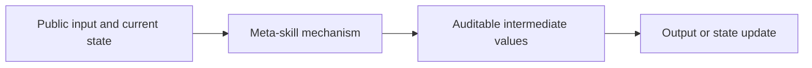
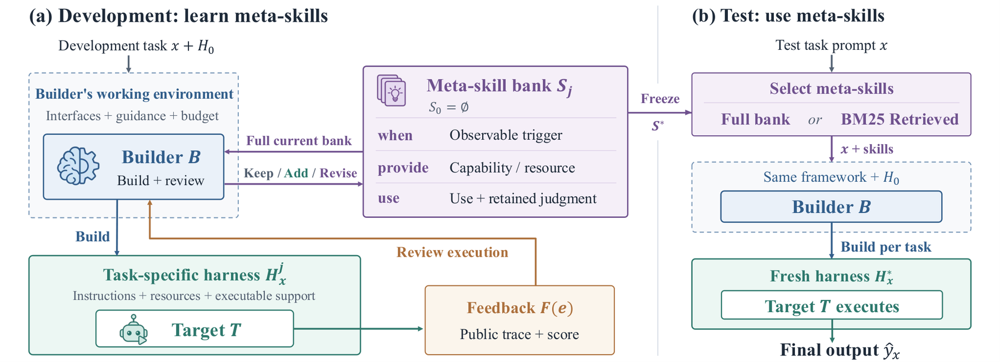

<!-- source-sha256: 61da70af1940e0bdb8f14d59d99c39a5c078c48fc6313b828ed5bab1a5afe466 -->

[简体中文](README.md) · English

# Learning Meta-Skills for Agent Harness Design in Test-Time AI4AI

> **L1 core mechanism diagnostic.** Refinement from development feedback and retrieval after freezing are implemented. Fixture rewards are not the AI4AI benchmark.

## Paper information

| Field | Details |
|---|---|
| Paper | [arXiv 2609.38143](https://arxiv.org/abs/2609.38143) |
| Institutions | Apodex / University of Illinois Urbana-Champaign (first author affiliations) |
| First public release | 2026-09-29 (arXiv v1) |
| Original source code | Yes: [qiancheng-apodex/MetaSkill-AI4AI](https://github.com/qiancheng-apodex/MetaSkill-AI4AI) |
| Adapter | `meta-skills` |
| Local reproduction code | [`src/auto_research/agent_research/latest_20261001.py`](https://github.com/daiwk/auto-research/blob/main/src/auto_research/agent_research/latest_20261001.py) |

## Original paper summary

### Background and main changes

Distill meta-skills with when, provide and use fields from harness feedback on development tasks, then freeze the skill bank. Test tasks retrieve relevant meta-skills to build a new harness without writing test results back.

<!-- paper-figure:start -->
### Key figure from the paper

> **Figure 1:** Main architecture, modules and connections. From the [paper](https://arxiv.org/abs/2609.38143); copyright belongs to the authors. Click for the source.
<!-- paper-figure:end -->

### Core equations

$s=(when,provide,use)$, with development loop $S_{j+1}=Revise(S_j,\{(H_x^j,F(e_x^j))\})$. The local bank accepts development feedback only; test selection cannot write back.

### Offline and online results

The paper reports +8.95 percentage points over no skills and +12.02 over direct reuse of a fixed skill bank. These gains are not extrapolated to local fixtures.

## Local reproduction

> **Comparison protocol:** Disabled or default mechanism versus enabled core operator. Only invariants and state transitions are checked; cross-model relative change is not applicable.

See [`metrics/mechanism-seeds42-44.json`](metrics/mechanism-seeds42-44.json) for the three-seed diagnostic. `diagnostic_only=true` means executable state transitions, gradients or scheduling invariants, not formal capability ranking.

## Scope

Development feedback refinement and frozen retrieval execute. Fixture rewards are not AI4AI benchmark scores.
