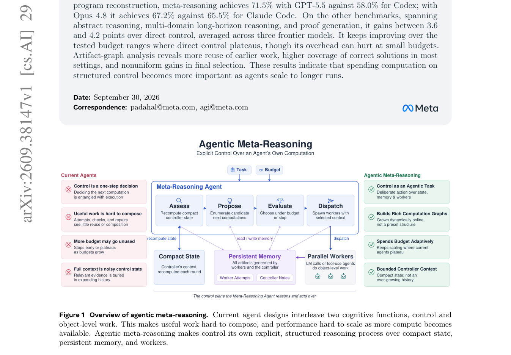

# Thinking Before Thinking: Scaling Agentic Inference Through Meta-Reasoning

<!-- source-sha256: 9faba6f6bde5e470212651149a15a782ba7c2fa445eca6e28d2cfc4875727f67 -->

[简体中文](README.md)

> **L1 core-mechanism diagnostic.** Implements budget feasibility, Evaluate/Dispatch selection, and separation of persistent artifacts from compact state. No frontier workers run; ProgramBench scores are not local.

## Paper information

| Field | Details |
|---|---|
| Paper | [arXiv 2609.38147](https://arxiv.org/abs/2609.38147) |
| Organization | First-author affiliation: Meta Superintelligence Labs |
| First public release | 2026-09-29 (arXiv v1) |
| Authors' code | No public author repository was found as of 2026-10-01. |
| Adapter | `meta-reasoning` |
| Local reproduction code | [`src/auto_research/agent_research/latest_20261001.py`](https://github.com/daiwk/auto-research/blob/main/src/auto_research/agent_research/latest_20261001.py) |

## Original paper

### Motivation and method

Workers handle object-level tasks, while a controller splits control into Assess, Propose, Evaluate, and Dispatch. The controller carries compact state, reuses work via persistent artifact memory, and decides whether to continue, branch, or stop within a shared call budget.

~~~mermaid
flowchart LR
  I[Public input and current state] --> M[Meta-reasoning mechanism]
  M --> A[Auditable intermediates]
  A --> O[Output or state update]
~~~

<!-- paper-figure:start -->
### Key figure from the paper

> **Figure 1:** Core architecture, modules, and their connections. From the [original paper](https://arxiv.org/abs/2609.38147); copyright remains with the authors.
<!-- paper-figure:end -->

### Core equations

$s_t=Assess(x,s_{t-1},\Delta M_t;M_t)$, $\tilde a_t=Evaluate(x,s_t,b_t,\mathcal A_t;M_t)$, then $a_t=Dispatch(\cdot)$. The local implementation ranks feasible actions by expected value per call cost and keeps complete artifacts in persistent memory.

### Paper results

On ProgramBench, GPT-5.5 scored 71.5% versus Codex at 58.0%, while Opus 4.8 scored 67.2% versus Claude Code at 65.5%. Other long-horizon tasks gained 3.6–4.2 points on average over direct control.

## Local reproduction

> **Local comparison:** The baseline disables the mechanism or uses the default state, and the treatment enables the core operator. This checks invariants and state transitions only; cross-model relative changes are not applicable.

See the [three-seed diagnostic](metrics/mechanism-seeds42-44.json). `diagnostic_only=true` indicates runnable transitions, gradients, or scheduling invariants only, not eligibility for capability ranking.

## Reproduction boundaries

Budget feasibility, Evaluate/Dispatch selection, and separation of persistent artifacts from compact state are implemented. No frontier workers are called; ProgramBench results are not local.
