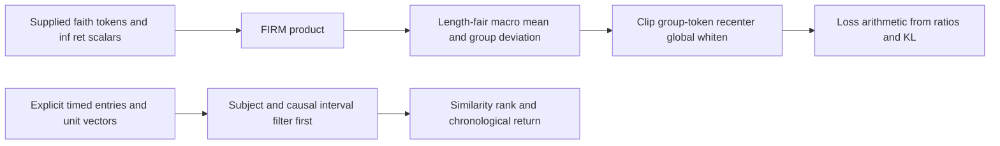
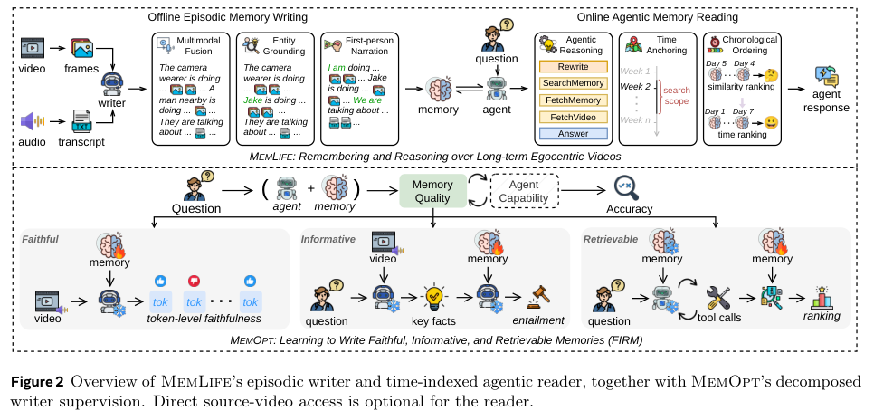

# MemLife: Curating and Reasoning over Long-Term Egocentric Video Memories

<!-- source-sha256: 052bca04c8531bc8aee8775449296e3b4905bead5cf9e61a95d5f93d3faad6ea -->

[简体中文](README.md)

> `component_only` / L1 CPU mechanism diagnostic, not capability reproduction or executable Evolve integration. This is a historical addition first released September30 and discovered through a November21 official repository event, not a new paper today. High-cost full experiments are not reproduced (review DONE).

## Paper information

| Field | Value |
| --- | --- |
| Paper | [Fixed v1](https://arxiv.org/abs/2609.40195v1) |
| First author and affiliation | Guangzhi Xiong; Meta Reality Labs / University of Virginia（Work done at Meta） |
| Original publication | 2026-09-30 17:11:33 UTC; announcement date not separately verified; official repository event observed2026-11-21 |
| Original source code | Yes: [fixed official Meta commit](https://github.com/facebookresearch/MemLife/tree/4d987734f65832eb950fb8e7c346d7e69cc2ce16),CC-BY-NC-4.0 code/data. Local arithmetic is independently derived from paper equations, not copied from that repository. |
| Local adapter / key | No full adapter (`adapter: null`); component `memlife` |
| Local code | `src/auto_research/agent_research/memlife.py`; tests `tests/test_nov21_memlife.py` |

## Original paper summary

### Background and changes

MemLife writes video frames and speech into time-anchored,entity-grounded first-person episodes,then lets a reader search semantically and fetch intervals. MemOpt trains only the writer while freezing the reader. FIRM multiplies token-level faithfulness with candidate-level informativeness and retrievability: source grounding,retention of answer-relevant facts,and recovery through cached reader actions are assessed separately instead of conflating writer quality with an entire reader trajectory's success.

Eq.11 averages response tokens within each candidate before macro-averaging candidates,preventing long memories from dominating the baseline. Variance macro-averages token deviations around the same group mean,not each candidate's own mean; the latter would discard between-candidate informativeness/retrievability signal. Eq.12 normalization is clipped to plus/minus3,then response-token-recentered within each group,and finally globally mask-whitened. Prompt/padding positions stay excluded. KL is an Eq.16 loss term,not part of FIRM or advantage statistics. Training QA may construct training rewards,but the question-independent writer and evaluated reader cannot read test answers.

### Architecture



### Key original figure

[](https://arxiv.org/pdf/2609.40195v1#page=4)

Figure2 and original caption from fixed-v1 PDF page4; copyright belongs to the original authors. Only unrelated text/whitespace is cropped; scientific content is unchanged. [Source](https://arxiv.org/pdf/2609.40195v1#page=4) and [crop/SHA256 provenance](assets/provenance.json). This illustrates the author's method, not local evidence.

### Core equations

$$
x_{i,t}=R_{faith,i,t}R_{inf,i}R_{ret,i},\qquad\mu_g=\frac1G\sum_i\frac1{L_i}\sum_t x_{i,t},\qquad\sigma_g^2=\frac1G\sum_i\frac1{L_i}\sum_t(x_{i,t}-\mu_g)^2,\qquad\widetilde A_{i,t}=\frac{x_{i,t}-\mu_g}{\sigma_g+\epsilon_n}.
$$

### Reported offline and online results

Table1 reports SuperMemory-VQA accuracy56.50 for untrained MemLife versus49.28 for EgoRAG,a7.22-percentage-point difference. MemOpt raises MemLife to60.35,another3.85points. Training uses subjectsS1-S6,validationS7-S8 and testS9-S10; checkpoint selection maximizes validation accuracy plus retrieval recall,with other benchmarks test-only. Oracle Context supplies annotated evidence directly and is not normal reader input. No production A/B is reported; none of these scores is measured locally.

## Local reproduction and limits

### Data protocol and code mapping

The local slice takes explicit probability/reward arrays and response masks for the Eq.7 margin,FIRM product,Eq.11-12 macro statistics,clipping/group-token recentering/global whitening,and Eq.16 scalar loss from supplied ratios,advantages and KL. An independently derived NumPy float64 protocol uses normalization epsilon1e-6,whitening epsilon1e-8 and sample-variance correction1; bitwise trainer equivalence is not claimed. Empty candidates are excluded fromG,empty groups output zero,and fewer than two valid batch tokens are rejected. Bounded unit-vector SearchMemory/FetchMemory first filter full interval containment and end<=query_time,then rank and return chronologically. Single-subject filtering is a local isolation contract,not the paper's mixed-subject LVQA benchmark or caller authentication. No video/embedding model,VLM judge,writer/reader,training-data construction,cached-reader trace collection,RL trainer or Evolve integration is implemented.

```bash
PYTHONPATH=src python -c 'from auto_research.agent_research.memlife import diagnostic; print(diagnostic(42))'
PYTHONPATH=src python -m pytest tests/test_nov21_memlife.py -q
```

Only explicit synthetic control inputs are used. No capability benchmark is loaded and no hyperparameters are selected on test data. After the batch source freeze, the shared runner writes [three-seed CPU diagnostics](metrics/component-cpu-seeds42-44.json). Three seeds do not promote L1 evidence or constitute independent model training.

### Same-topic comparison and limits

Reviewed against [agent-research:memfolder](../2611.26427-memfolder/README-en.md): MemFolder mainly changes how existing memories are grouped,merged and encoded;MemOpt changes what a writer generates and how training credit is assigned. Structural compression and writer rewards do not substitute for one another. ContextFolder's blind reader cannot see source records/expected answers;MemOpt training judges may use source video and training QA,but those inputs must not reach the evaluated reader. Both local slices areL1 mathematics,so group counts or advantage variances cannot compare QA accuracy.

Unequal-length candidates distinguish a macro mean.5 from pooled-token mean.25,and group variance.25 from zero within-candidate variance. Sparse outliers check post-clip recentering. Valid response rewards are restricted to[0,1];extreme finite padding is erased before arithmetic,and overflow from finite ratios times advantages or KL terms is rejected rather than returning infinity or disguising an overflowed variance as zero advantage. Further controls cover flat groups,empty candidates/padding,invalid probabilities,KL affecting only the separate loss,and future/other-subject entries excluded before ranking while exact-cutoff entries remain available. Inputs are explicit synthetic controls,no gold QA or video is passed to a reader,and pass rates are not video-QA capability.

### High-cost full experiments

The fixed paper evaluates9B writer/reader and27B transfer combinations over long video histories,trains for three epochs,and rebuilds memories and reader traces. The pinned official repository's full setup requires one eight-GPU training node and one eight-GPU evaluation node. This is not an affordable equivalent on oneA100/A30 or a Mac. Full training/benchmarks are not reproduced; no weights/videos or trial runs are launched,only small CPU array controls. **Too costly; not reproduced (review DONE).** This is a terminal decision, not an automatic retry or implementation queue. Passing the cheap slice does not reproduce the full paper.
