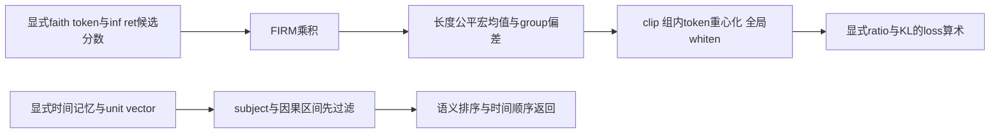
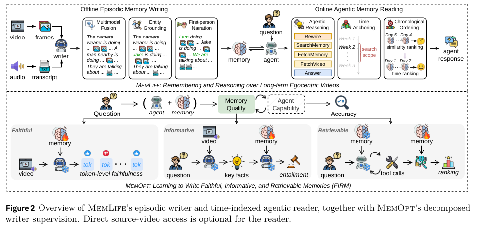

# MemLife / MemOpt：把忠实、信息保留和可检索性分解给记忆写入器

> `component_only` / L1 CPU机制组件，`diagnostic_only=true`。这是9月30日首发、11月21日官方仓库事件发现的历史补漏，不算本日新论文。高成本完整实验不复现（审查 DONE），不是能力复现或已接入Evolve。

## 论文信息

| 字段 | 内容 |
| --- | --- |
| 论文链接 | [MemLife: Curating and Reasoning over Long-Term Egocentric Video Memories](https://arxiv.org/abs/2609.40195v1)，本轮固定v1 |
| 公司/机构/学校 | 一作Guangzhi Xiong；Meta Reality Labs / University of Virginia（Work done at Meta） |
| 首次公开日期 | 2026-09-30 17:11:33 UTC，arXiv v1；本轮未单独核验公告日；2026-11-21发现官方仓库事件 |
| 原作者开源代码 | 是：[Meta官方固定提交](https://github.com/facebookresearch/MemLife/tree/4d987734f65832eb950fb8e7c346d7e69cc2ce16)，代码/数据为CC-BY-NC-4.0；本地按论文公式独立实现，未复制该仓库代码。 |
| 本地 Adapter / 方法 | 无完整adapter（`adapter: null`）；组件key `memlife` |
| 本地复现代码 | `src/auto_research/agent_research/memlife.py`；测试 `tests/test_nov21_memlife.py` |

## 原始论文总结

### 背景与主要改动

MemLife先把每段第一视角视频和语音写成有时间锚点、实体落地的第一人称文本，再由reader按问题进行语义搜索和时间区间读取。MemOpt只训练writer，reader保持冻结；FIRM将逐token的faithfulness、逐候选的informativeness和retrievability相乘。前者看源视频是否支持内容，后两者分别看回答所需事实是否被保留、已缓存reader动作能否找回该候选，不把完整reader成败混成一个写入奖励。

Eq.11先对每个候选的response token求均值，再对候选做宏平均，避免长记忆独占基线。方差是每个候选围绕同一group均值的token偏差平方再宏平均，不能改成候选内部方差，否则丢掉informativeness/retrievability的候选间信号。Eq.12归一化后先clip到±3，再按组中有效response token加权重心化，最后全局masked whitening；prompt和padding始终排除。KL属于Eq.16 loss项，不进入FIRM奖励或优势统计。训练reward可用训练问答，问题独立的writer与被评测reader不可读测试答案。



<!-- paper-figure:start -->
### 原论文关键图

[](https://arxiv.org/pdf/2609.40195v1#page=4)

图片来自[原论文](https://arxiv.org/pdf/2609.40195v1#page=4)固定v1第4页Figure 2及原始图注，版权归原作者所有；仅裁去无关正文/留白，科学内容未修改。[来源与裁剪SHA256](assets/provenance.json)。这是作者方法图，不是本地实验。
<!-- paper-figure:end -->

### 核心公式

$$
x_{i,t}=R_{faith,i,t}R_{inf,i}R_{ret,i},\qquad\mu_g=\frac1G\sum_i\frac1{L_i}\sum_t x_{i,t},\qquad\sigma_g^2=\frac1G\sum_i\frac1{L_i}\sum_t(x_{i,t}-\mu_g)^2,\qquad\widetilde A_{i,t}=\frac{x_{i,t}-\mu_g}{\sigma_g+\epsilon_n}.
$$

### 论文离线与线上效果

Table1中SuperMemory-VQA：训练前MemLife准确率56.50、EgoRAG49.28，相差7.22个百分点；MemOpt将MemLife提高到60.35，再增3.85个百分点。训练使用S1–S6，validation为S7–S8，test为S9–S10；按validation的准确率加检索recall选checkpoint，其他benchmark仅作test。Oracle Context直接提供标注证据，不是正常reader的可用输入。论文没有生产线上A/B，以上不属于本地测量。

## 本地复现与边界

### 数据协议与代码映射

本地只接收显式概率/奖励数组与response mask，执行Eq.7的概率差、FIRM乘积、Eq.11-12宏统计、clip/组内token重心化/全局whitening和Eq.16已给ratio/advantage/KL的标量loss算术。独立NumPy float64实现，normalization epsilon=1e-6，whitening epsilon=1e-8、样本方差correction=1作为显式数值协议；不声称与外部trainer逐bit相同。空候选从G排除，空group输出0；全batch少于2个有效token则拒绝，不补造whitening。另有最多512条的显式unit-vector SearchMemory/FetchMemory：先按end≤query_time及区间完整包含过滤，再排序；返回按时间排列。单subject过滤是本地隔离合同，不是论文LVQA混合受试者基准，也不认证调用者身份。没有视频/embedding模型、VLM评审、writer/reader、训练数据构建、cached reader trace生成、RL训练或Evolve接入。

```bash
PYTHONPATH=src python -c 'from auto_research.agent_research.memlife import diagnostic; print(diagnostic(42))'
PYTHONPATH=src python -m pytest tests/test_nov21_memlife.py -q
```

本轮只用显式合成控制输入，不加载公开能力benchmark，不存在据test选超参的流程。批次冻结源码后的统一runner生成[42/43/44三种子CPU诊断](metrics/component-cpu-seeds42-44.json)，三种子不改变L1层级，也不是三个独立模型训练。

### 同主题比较与边界

与[agent-research:memfolder](../2611.26427-memfolder/README.md)对照：MemFolder主要改变已有记忆如何分组、合并与编码，MemOpt则改变writer生成什么文本以及如何分配训练credit；前者的结构压缩和后者的写入奖励不互相替代。MemFolder的ContextFolder blind reader看不到源记录/预期答案；MemOpt训练评审可用源视频和训练问答，但这些信息不得流向被评测reader。二者本地都是L1数学组件，不能把分组数或优势方差当QA准确率比较。

长度不等候选构造宏均值0.5而token池均值0.25，检验group方差0.25而非候选内方差0；稀疏离群值检验clip后重心化。有效response奖励限定[0,1]；极大有限padding先归零，有限输入的ratio乘advantage或KL项溢出也明确拒绝，不能输出inf或把溢出方差伪装成零优势。负控还包括全平group、空候选/padding、无效概率、KL只影响独立loss、不改变奖励、严格未来片段和其他subject在检索前排除、恰好query_time的片段可用。所有输入是合成显式控制值，没有任何gold QA或视频内容输入reader；通过率不是长视频QA能力。

### 高成本完整实验

固定论文以9B writer/reader和27B迁移组合处理长时视频，writer训练3个epoch并每轮重建记忆和reader trace；官方固定仓库完整训练要求一个8卡训练节点及一个8卡评估节点。单A100/A30或Mac不能廉价等价复现实验矩阵，完整训练和benchmark直接不复现；不下载权重或视频、不启动试跑，只做小数组CPU控制。 **成本过高，不复现（审查 DONE）。** 完整实验是已终态的成本决定，不进入自动重试或实现队列；便宜组件通过不等于完整论文已被复现。
