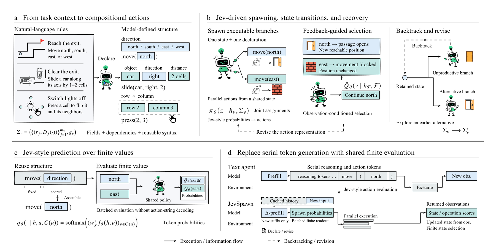

# JevSpawn: Adaptive Agentic Inference through Compositional Action Spaces

<!-- source-sha256: d486ac336ff75637e164c08ebfd51a7f8471895d50e3cc2439a03f711d821b51 -->

[简体中文](README.md)

> L1 mechanism diagnostic of finite-action posterior updates and top-branch retention; no Jev checkpoint.

## Paper information

| Field | Details |
|---|---|
| Paper | [arXiv v1](https://arxiv.org/abs/2610.00437) |
| Institution | The paper's first page does not list an affiliation for the first author. |
| First public release | 2026-09-30 (arXiv v1) |
| Author code | No public author implementation found as of 2026-10-03. |
| Local adapter or method key | `jev-spawn` |
| Local reproduction code | [`src/auto_research/agent_research/latest_20261003.py`](https://github.com/daiwk/auto-research/tree/main/src/auto_research/agent_research/latest_20261003.py) |

## Paper method and evidence

Build a finite compositional action space from the natural-language task. Use a Jev distribution to keep multiple branches in parallel, then update the posterior from feedback and retain alternatives to recover from failure.

<!-- paper-figure:start -->
### Original paper figure

Figure 2 shows the architecture and how its components connect. From the [original paper](https://arxiv.org/abs/2610.00437); copyright remains with the authors.
<!-- paper-figure:end -->

### Core equation

$p'(a)\propto p(a)e^{feedback(a)}$.

### Reported results

The authors evaluate speed, cost, and success rate across eight tasks and seven agent baselines.

## Local reproduction

Compare with the mechanism disabled/default state. The [three-seed diagnostic](metrics/mechanism-seeds42-44.json) is `diagnostic_only=true`; no formal gain or capability ranking.
