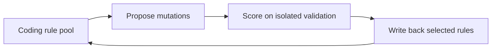
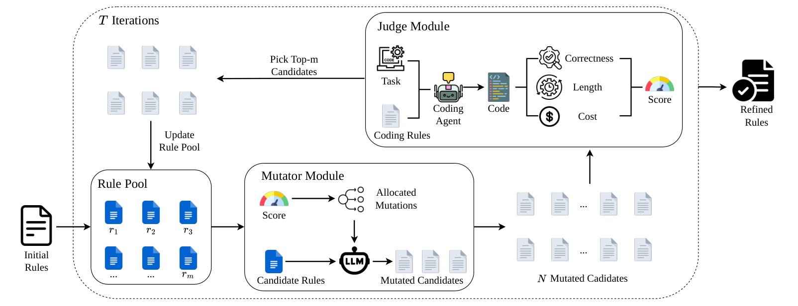

# Self-Evolving Coding Rules for AI Coding Agents

<!-- source-sha256: b10625a0f3067aaa153ce3df2e6c4f5ba7357dc201b59e2d5d5f383d248b6913 -->

[简体中文](README.md)

> L1 validation-only selection after mutation; no LLM mutator is called.

## Paper information

| Field | Details |
|---|---|
| Paper | [arXiv v1](https://arxiv.org/abs/2610.00650) |
| Institution | The paper's first page does not list an affiliation for the first author. |
| First public release | 2026-09-30 (arXiv v1) |
| Author code | No public author implementation found as of 2026-10-03. |
| Local adapter or method key | `rule-evolve` |
| Local reproduction code | [`src/auto_research/agent_research/latest_20261003.py`](https://github.com/daiwk/auto-research/tree/main/src/auto_research/agent_research/latest_20261003.py) |

## Paper method and evidence

Maintain a pool of coding rules, generate variants with a mutator, then select and persist better rules using only an isolated validation evaluator.

<!-- paper-figure:start -->
### Original paper figure

Figure 1 shows mutation, validation selection and write-back. From the [original paper](https://arxiv.org/abs/2610.00650); copyright remains with the authors.
<!-- paper-figure:end -->

### Core equation

$r^*=argmax_{r\in pool\cup mutate(pool)}Score_{val}(r)$.

### Reported results

Across two coding agents, four models, and three benchmarks the paper reports gains over handwritten rules and prompt-optimization baselines.

## Local reproduction

Compare against the mechanism disabled or in its default state. The [three-seed diagnostic](metrics/mechanism-seeds42-44.json) is `diagnostic_only=true`; no formal relative gain or capability ranking.
