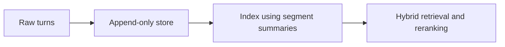
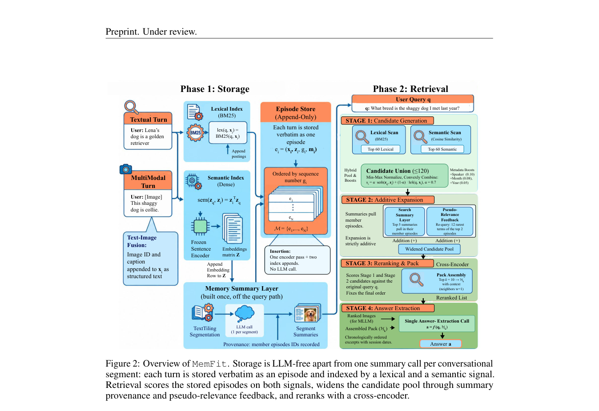

# MemFit: Efficient Long-Term Agentic Memory

<!-- source-sha256: 867ea5f89bc64ded3eade1195bd96d8c151da544e846af1c9ae2be76bb816c13 -->

[简体中文](README.md)

> L1 append-only and hybrid-retrieval hook diagnostic; no embedding model or cross-encoder is called.

## Paper information

| Field | Details |
|---|---|
| Paper | [arXiv v1](https://arxiv.org/abs/2610.00872) |
| Institution | The paper's first page does not list an affiliation for the first author. |
| First public release | 2026-09-30 (arXiv v1) |
| Author code | No public author implementation found as of 2026-10-03. |
| Local adapter or method key | `memfit` |
| Local reproduction code | [`src/auto_research/agent_research/latest_20261003.py`](https://github.com/daiwk/auto-research/tree/main/src/auto_research/agent_research/latest_20261003.py) |

## Paper method and evidence

Append original turns without rewriting and use segment summaries only to build the index. Reads combine lexical, semantic, and reranking signals, avoiding expensive LLM writes.

<!-- paper-figure:start -->
### Original paper figure

Figure 2 shows the memory pipeline. From the [original paper](https://arxiv.org/abs/2610.00872); copyright remains with the authors.
<!-- paper-figure:end -->

### Core equation

$score=lexical+semantic$; writes are append-only.

### Reported results

The authors report lower write latency and cost than LLM-based memory pipelines while retaining long-term QA quality.

## Local reproduction

Compare with the mechanism disabled/default state. The [three-seed diagnostic](metrics/mechanism-seeds42-44.json) is `diagnostic_only=true`; no formal gain or capability ranking.
