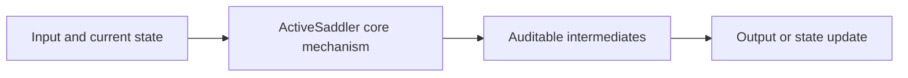
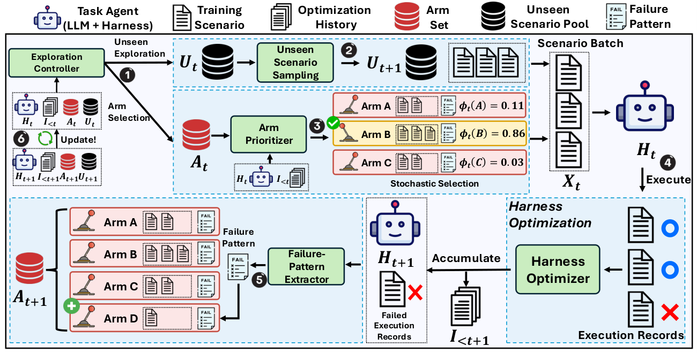

<!-- source-sha256: ac067a466b99868dd7fc654ddc8f488c67dc824976361b7e3c6500fa32b16bf6 -->

[简体中文](README.md) · English

# ActiveSaddler: Automated Curriculum Learning for Agent Harness Optimization

> **L1 core mechanism diagnostic.** Dynamic failure arms and exploration/exploitation scheduling run without calling AutoSaddler or real GAIA2/Terminal-Bench environments.

## Paper information

| Field | Details |
|---|---|
| Paper | [arXiv 2610.00906](https://arxiv.org/abs/2610.00906) |
| Institution | POSTECH (first author affiliation) |
| First public release | 2026-10-01 (arXiv v1) |
| Original source code | Yes: [microsoft/AutoSaddler, ActiveSaddler branch](https://github.com/microsoft/AutoSaddler/tree/feat/activesaddler) |
| Adapter | `active-saddler` |
| Local reproduction code | [`src/auto_research/agent_research/latest_20261002.py`](https://github.com/daiwk/auto-research/blob/main/src/auto_research/agent_research/latest_20261002.py) |

## Original paper summary

### Background and main changes

Recurring failure patterns become dynamic, nonstationary bandit arms. A curriculum controller discovers new scenarios or revisits known weaknesses, updating priorities as harness repairs succeed or fail.

<!-- paper-figure:start -->
### Key figure from the paper

> **Paper figure:** Core architecture, training flow or protocol. From the [paper](https://arxiv.org/abs/2610.00906); copyright belongs to the authors. Click for the source.
<!-- paper-figure:end -->

### Core equation

$a_t=argmax_a[\hat v_a+c\sqrt{\log(t)/(n_a+1)}]$, with periodic Draw of unseen scenarios.

### Offline and online results

With the same harness optimizer and rollout budget, the paper reports GAIA2 Pass@1 +4.4 points and Terminal-Bench 2.0 +7.5 points.

## Local reproduction

> **Comparison protocol:** Disabled or default mechanism versus enabled operator. Relative percentages are not applicable; this checks invariants, gradients or state transitions, not paper-scale effects.

- Three-seed diagnostic: [`metrics/mechanism-seeds42-44.json`](metrics/mechanism-seeds42-44.json).
- `diagnostic_only=true`; excluded from formal capability rankings.

## Scope

Dynamic failure arms and exploration/exploitation scheduling run. AutoSaddler and actual GAIA2/Terminal-Bench environments are not called.
