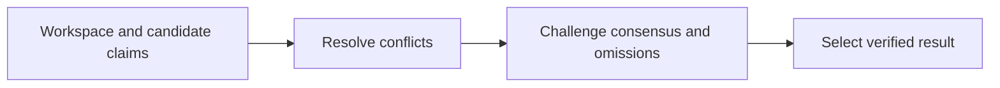
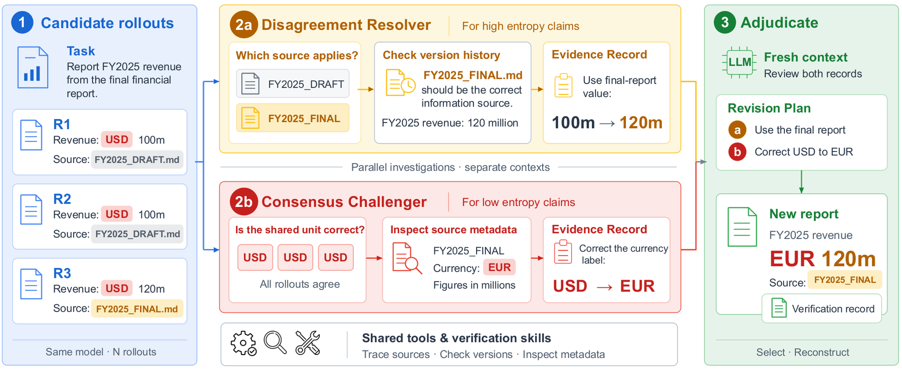

# VeriHarness: Scaling Agentic Verification for Long-Horizon Tasks

<!-- source-sha256: a18cc1d28ba3f2ab4324260bb218030efd5472b270f49b66ca66f5979eb2906b -->

[简体中文](README.md)

> **L1 mechanism diagnostic.** Evidence, conflict, and consensus-challenge selection; fixtures do not reproduce real tool use.

## Paper information

| Field | Value |
| --- | --- |
| Paper | [arXiv 2610.00972](https://arxiv.org/abs/2610.00972) |
| Affiliations | Google Cloud AI Research, first author's affiliation |
| First public release | 2026-10-01 (arXiv v1) |
| Authors' code | No public author implementation found as of 2026-10-02. |
| Adapter / method | `veriharness` |
| Local code | [`src/auto_research/agent_research/latest_20261002.py`](https://github.com/daiwk/auto-research/blob/main/src/auto_research/agent_research/latest_20261002.py) |

## Original paper

### Background and contribution

Give one base model a workspace, evidence tools, and reusable verification skills. A disagreement resolver investigates conflicting claims; a consensus challenger questions shared claims and missing requirements.

<!-- paper-figure:start -->
### Key figure from the paper

Original VeriHarness verification diagram. From the [paper](https://arxiv.org/abs/2610.00972); copyright belongs to the authors. Not a local result.
<!-- paper-figure:end -->

### Core mechanism

$score(y)=supported(y)-contradicted(consensus)-\epsilon|claims(y)|$.

### Paper results

Across five long-horizon workspace benchmarks, the paper reports 6.2 points for Gemini 3.5 Flash and 6.4 for Claude Opus 4.8 over single rollout, releasing about 26k rollouts.

## Local reproduction

Compare the disabled/default checker with the enabled mechanism. [Three-seed diagnostics](metrics/mechanism-seeds42-44.json) check invariants only (`diagnostic_only=true`), not relative capability.

## Reproduction limits

Fixture checking is not the paper's real tool environment.
