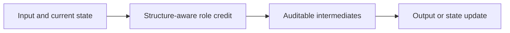
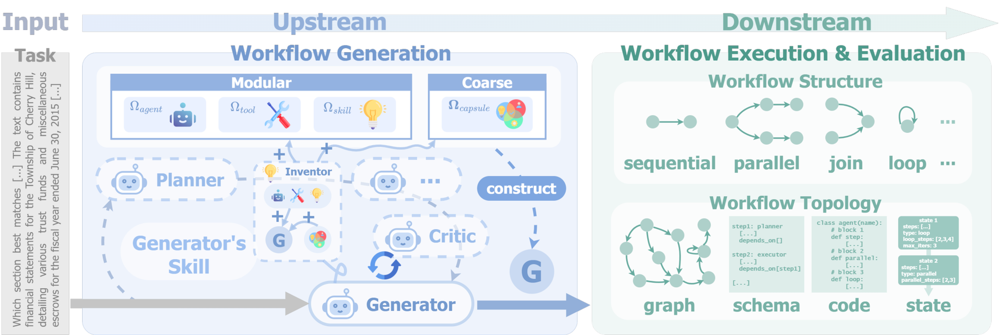

<!-- source-sha256: 8910a946b82b89796ffe598fc00eab8fbb0cf967dddd5b27a6748321472f48a6 -->

[简体中文](README.md) · English

# It Takes Workflows to Evolve Better Workflows

> **L1 core mechanism diagnostic.** Structure-aware credit redistribution conserves total credit. No workflows are generated, Qwen3.5 trained or DataWright run.

## Paper information

| Field | Details |
|---|---|
| Paper | [arXiv 2610.01026](https://arxiv.org/abs/2610.01026) |
| Institution | William & Mary (first author affiliation) |
| First public release | 2026-10-01 (arXiv v1) |
| Original source code | No public author implementation found as of 2026-10-02. |
| Adapter | `flowright` |
| Local reproduction code | [`src/auto_research/agent_research/latest_20261002.py`](https://github.com/daiwk/auto-research/blob/main/src/auto_research/agent_research/latest_20261002.py) |

## Original paper summary

### Background and main changes

Use workflow topology to turn sparse outcomes into hierarchical, structure-aware role credit. A single harness can then support single-role self-improvement, upstream/downstream collaboration or multi-agent co-evolution.

<!-- paper-figure:start -->
### Key figure from the paper

> **Paper figure:** Core architecture, training flow or protocol. From the [paper](https://arxiv.org/abs/2610.01026); copyright belongs to the authors. Click for the source.
<!-- paper-figure:end -->

### Core equations

$r_i=R\,w_i/\sum_jw_j$, where $w_i=valid_i(1+children_i)$.

### Offline and online results

The paper reports gains up to +7.41% across document, slide, chart, coding, math and finance tasks, with +5.03% overall for joint multi-role evolution versus +2.83% for one role.

## Local reproduction

> **Comparison protocol:** Disabled or default mechanism versus enabled operator. Relative percentages are not applicable; this checks invariants, gradients or state transitions, not paper-scale effects.

- Three-seed diagnostic: [`metrics/mechanism-seeds42-44.json`](metrics/mechanism-seeds42-44.json).
- `diagnostic_only=true`; excluded from formal capability rankings.

## Scope

Structure-aware credit redistribution runs. No workflow generation, Qwen3.5 training or DataWright.
