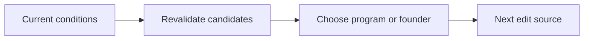
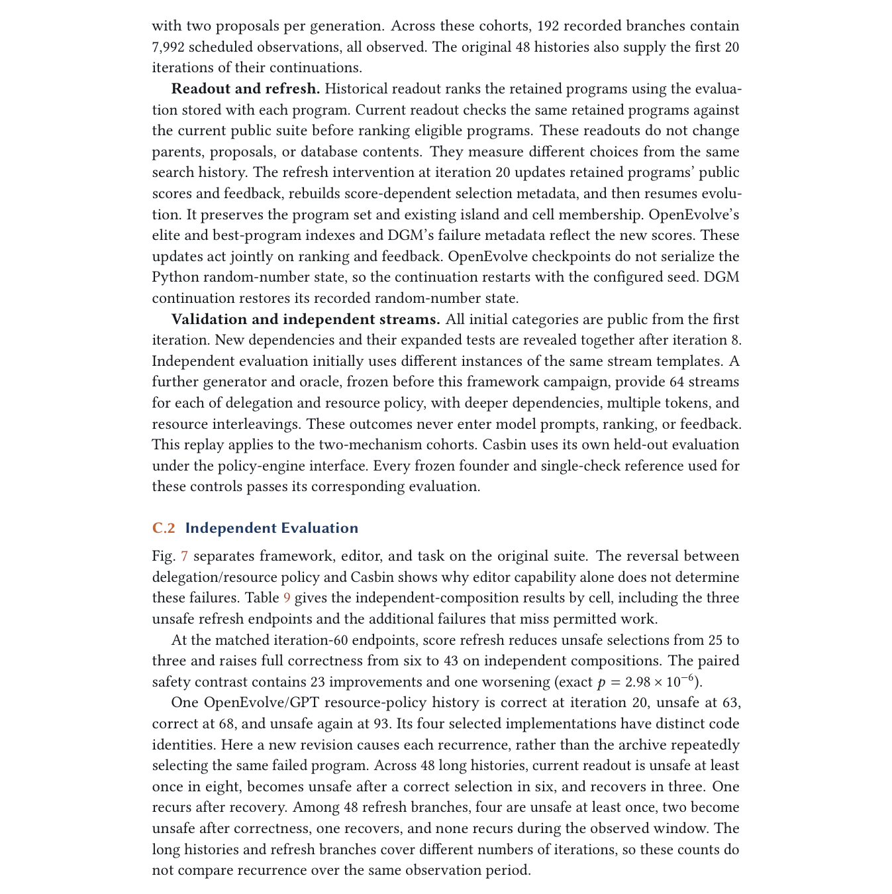

# Safety Must Survive Self-Improvement: Why Failures Persist and How Agents Recover

<!-- source-sha256: 6a5fc09f9c5fbc4d6936b5b2cada0b12d29576be9073a90079e42458232ffc0f -->

[简体中文](README.md)

> **L1 mechanism diagnostic.** Current validation and founder fallback; no paper editor or Amazon Bedrock reproduction.

## Paper information

| Field | Value |
| --- | --- |
| Paper | [arXiv 2610.01073](https://arxiv.org/abs/2610.01073) |
| Affiliations | First-author affiliation not listed on the paper's first page |
| First public release | 2026-10-01 (arXiv v1) |
| Authors' code | No public author implementation found as of 2026-10-02. |
| Adapter / method | `safe-self-improvement` |
| Local code | [`src/auto_research/agent_research/latest_20261002.py`](https://github.com/daiwk/auto-research/blob/main/src/auto_research/agent_research/latest_20261002.py) |

## Original paper

### Background and contribution

Separate detection, selection of today's runnable program, and source for the next edit. Revalidate all candidates in current conditions. If none passes, roll back to the founder instead of keeping an unsafe incumbent.

<!-- paper-figure:start -->
### Key figure from the paper

Original paper diagram of validation and rollback. From the [paper](https://arxiv.org/abs/2610.01073); copyright belongs to the authors. Not a local result.
<!-- paper-figure:end -->

### Core mechanism

$p_{run}=argmax_{p\in V_{current}} score(p)$. When $V_{current}=\varnothing$, run founder rollback.

### Paper results

Historical scores retained unsafe programs in 22 of 48 histories. Full validation with validated rollback ended correct in all core trajectory-study cases while retaining over 43% deployment savings.

## Local reproduction

Compare disabled/default versus enabled. [Three-seed results](metrics/mechanism-seeds42-44.json) are `diagnostic_only=true`; transitions, gradients, and invariants do not establish paper-scale effects.

## Reproduction limits

Validation and founder fallback only; no paper editing model or Amazon Bedrock experiment.
