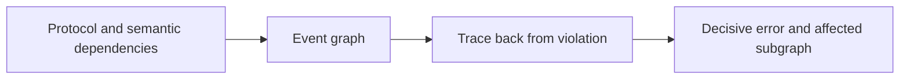
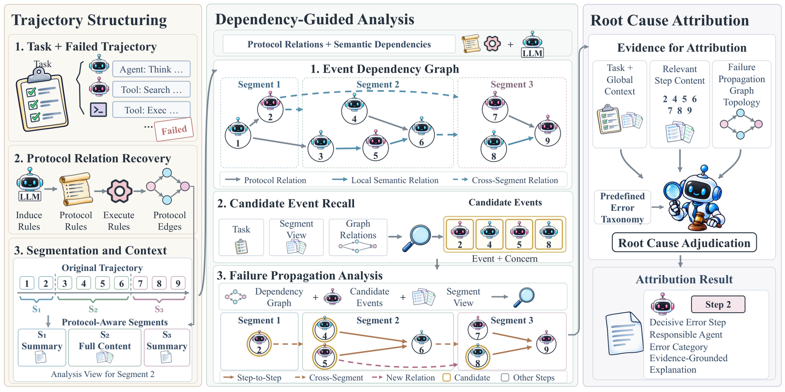

# DeFA: Dependency-Guided Failure Attribution for LLM Agents

<!-- source-sha256: da67b53d4ed0334cacc866bfa0c4487649b4587f204d9cb060dacef6074fb722 -->

[简体中文](README.md)

> L1 graph tracing and decisive-error selection; no gold answer/plan or multimodal judge.

## Paper information

| Field | Details |
|---|---|
| Paper | [arXiv 2610.01256](https://arxiv.org/abs/2610.01256) |
| Institution | Qwen DianJin Team, Alibaba Cloud Computing (first author). |
| First public release | 2026-10-01 (arXiv v1) |
| Author code | No public author implementation found as of 2026-10-02. |
| Local adapter or method key | `defa` |
| Local reproduction code | [`src/auto_research/agent_research/latest_20261002.py`](https://github.com/daiwk/auto-research/blob/main/src/auto_research/agent_research/latest_20261002.py) |

## Paper method and evidence

Fuse protocol relations and semantic dependencies into an event graph. Trace backward from a violation to possible sources, retain downstream consequences in a failure-propagation graph, and select the decisive error.

<!-- paper-figure:start -->
### Original paper figure

The original figure shows dependency-guided failure attribution. From the [original paper](https://arxiv.org/abs/2610.01256); copyright remains with the authors.
<!-- paper-figure:end -->

### Core equation

$e^*=argmax_{e\in Ancestor(V)} error(e)$; retain both the responsible agent and the propagation subgraph.

### Reported results

The paper reports the best responsible-agent and exact-step accuracy on Who and When, and 6–15 points of downstream gain with Trace2Skill.

## Local reproduction

[Three-seed mechanism results](metrics/mechanism-seeds42-44.json) are diagnostic_only=true. Fixed-budget fixtures verify the defining operator and auditable intermediate states; they are not a benchmark, production result, or capability-ranking entry. The comparator is the disabled/default operator, not an independently trained agent.
