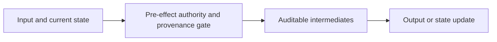
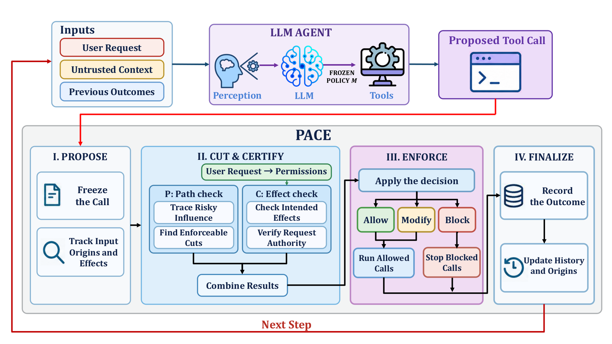

<!-- source-sha256: a48c56a24930ec4256724bb1f388fcd1726c008c414ff9080ecb70c2229189ec -->

[简体中文](README.md) · English

# PACE: Provenance-Aware Capability Enforcement for Tool-Using LLM Agents

> **L1 core mechanism diagnostic.** The pre-effect capability and provenance gate runs without browsers or system tools.

## Paper information

| Field | Details |
|---|---|
| Paper | [arXiv v1](https://arxiv.org/abs/2610.01349) |
| Institution | The first page does not list the first author's affiliation. |
| First public release | 2026-10-01 (arXiv v1) |
| Original source code | No public author implementation found as of 2026-10-03. |
| Adapter | `pace-capability` |
| Local reproduction code | [`src/auto_research/agent_research/latest_20261003.py`](https://github.com/daiwk/auto-research/tree/main/src/auto_research/agent_research/latest_20261003.py) |

## Original paper summary

### Background and main changes

Before every tool side effect, check it against authority compiled from the authenticated request and also check input provenance. Content accepted at ingestion is not necessarily trustworthy at execution.

<!-- paper-figure:start -->
### Key figure from the paper

> **Figure 1:** Overall design and components. From the [paper](https://arxiv.org/abs/2610.01349); copyright belongs to the authors. Click for the source.
<!-- paper-figure:end -->

### Core equation

$allow=effects(call)\subseteq authority\land trusted(provenance)$.

### Offline and online results

The paper presents an authenticated execution contract and evaluation against multiple injection-attack classes.

## Local reproduction

> **Comparison protocol:** Disabled or default mechanism versus its defining operator. L1 does not report formal relative gains; percentages are not applicable.

- Three-seed diagnostic: [`metrics/mechanism-seeds42-44.json`](metrics/mechanism-seeds42-44.json).
- `diagnostic_only=true`; excluded from formal capability rankings.

## Scope

The pre-effect capability and provenance gate runs. Browsers and system tools are not executed.
