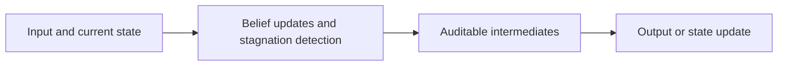
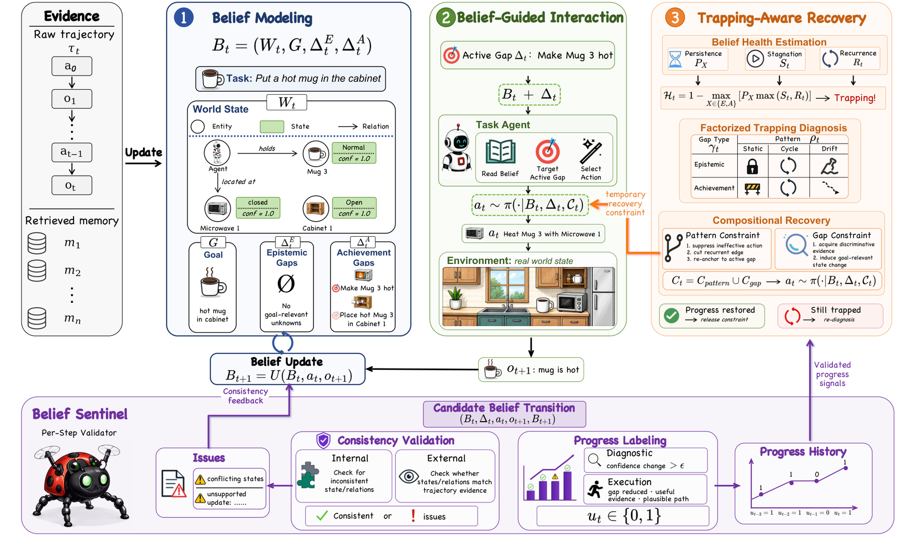

<!-- source-sha256: cc20fb1de0627bb578f61ef7875a6af0db3daae8d8ba86cadd325fecf3a69ad2 -->

[简体中文](README.md) · English

# Beyond Memory: Harnessing Long-Horizon Agents with Explicit Belief States

> **L1 core mechanism diagnostic.** Belief updates and stagnation detection run. No external tool environment is called.

## Paper information

| Field | Details |
|---|---|
| Paper | [arXiv v1](https://arxiv.org/abs/2610.01415) |
| Institution | The first page does not list the first author's affiliation. |
| First public release | 2026-10-01 (arXiv v1) |
| Original source code | No public author implementation found as of 2026-10-03. |
| Adapter | `belief-state-pos` |
| Local reproduction code | [`src/auto_research/agent_research/latest_20261003.py`](https://github.com/daiwk/auto-research/tree/main/src/auto_research/agent_research/latest_20261003.py) |

## Original paper summary

### Background and main changes

Explicitly maintain current world facts and unresolved task requirements as a belief. Repeated actions that do not reduce unresolved requirements indicate Belief Trapping and trigger targeted recovery.

<!-- paper-figure:start -->
### Key figure from the paper

> **Figure 2:** Overall design and components. From the [paper](https://arxiv.org/abs/2610.01415); copyright belongs to the authors. Click for the source.
<!-- paper-figure:end -->

### Core equations

$b_t=(facts_t, unresolved_t)$; $\Delta|unresolved|\ge0$ marks stagnation.

### Offline and online results

The paper reports improved long-horizon agent success on four execution and diagnostic benchmarks.

## Local reproduction

> **Comparison protocol:** Disabled or default mechanism versus its defining operator. L1 does not report formal relative gains; percentages are not applicable.

- Three-seed diagnostic: [`metrics/mechanism-seeds42-44.json`](metrics/mechanism-seeds42-44.json).
- `diagnostic_only=true`; excluded from formal capability rankings.

## Scope

Belief updates and stagnation detection run without any external tool environment.
