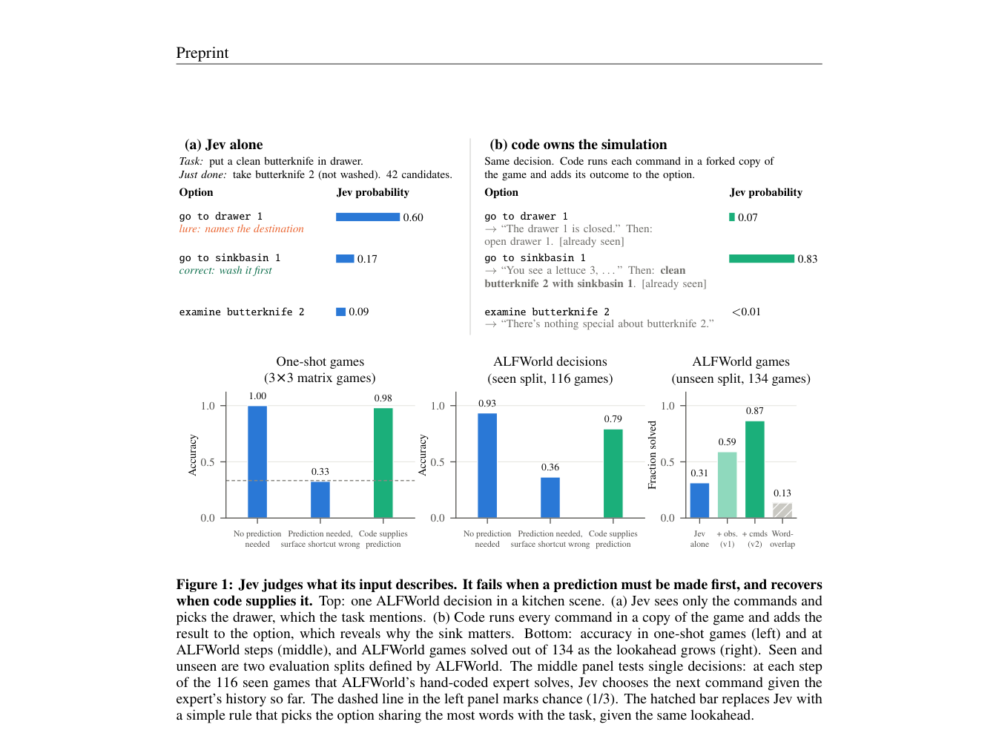

# Code Owns the Simulation, Jev Owns the Evaluation

<!-- source-sha256: a1e5bcdedda6f5b34fbd517680de018e453aa118cabe60e9addb0b794d3a2267 -->

[简体中文](README.md)

> **L1 core-mechanism diagnostic.** Clones actual environments, executes branches, and calls the existing provider interface. The local run uses an explicitly lexical diagnostic provider, not real Jev or a reproduction of ALFWorld success rates.

## Paper information

| Field | Details |
|---|---|
| Paper | [arXiv 2610.01834](https://arxiv.org/abs/2610.01834) |
| Organization | The Chinese University of Hong Kong; first author Yaodong Yang |
| First public release | 2026-10-01 (arXiv v1) |
| Authors' code | No public author repository was found during the 2026-10-04 full-text review. |
| Adapter | `jev-lookahead`, Python mechanism API rather than a reproduce CLI adapter |
| Local reproduction code | [`src/auto_research/system_one/lookahead.py`](https://github.com/daiwk/auto-research/blob/main/src/auto_research/system_one/lookahead.py) |

## Original paper

### Motivation and method

Executable code simulates each action's successor state; Jev only compares the progress afforded by actions. In addition to the action and next observation, the evaluator receives newly available actions after execution, addressing the difficulty of inferring long-term reachability from semantic action scores alone.

~~~mermaid
flowchart LR
  S[Current real environment] --> F[Clone once per legal action]
  F --> E[Execute one step per independent copy]
  E --> O[Next observation and newly legal actions]
  O --> J[Structured Jev action scoring]
  J --> C[Return selected action]
  C --> R[Caller executes in real environment]
~~~

<!-- paper-figure:start -->
### Key figure from the paper

> **Figure 1:** Method overview and key components. From the [original paper](https://arxiv.org/abs/2610.01834); copyright remains with the authors.
<!-- paper-figure:end -->

### Core equations

For action $a$, $s'_a=\operatorname{step}(\operatorname{clone}(s),a)$ and $\Delta A_a=A(s'_a)\setminus A(s)$. The decision maker sees only $a,o(s'_a),\Delta A_a$ and public task history, not simulator reward, gold plans, or success labels.

### Paper results

On 134 unseen ALFWorld tasks, the paper reports 42 raw successes, 79 with the next observation, and 116 with newly available actions as well (about 87%). Robot skill selection succeeds in 22/40 trials versus 3/40 for a handwritten selector; the direct raw-torque route succeeds in 0/20. Results across tasks are not directly comparable. No production online A/B test is reported.

## Local reproduction

Run `PYTHONPATH=src python scripts/run_oct04_seven_papers.py`.

- `simulate_options(environment)` clones independently per action, rejects `fork()` returning the original object, and does not change real state.
- `choose_with_lookahead(environment, provider, task=..., observation=...)` reuses System One `ChoiceQuestion` and `SystemOneRequest`, verifies a legal candidate, and does not execute the real action itself.
- The environment provides `fork/admissible_commands/step`, and `step` returns only an observable string. The caller must isolate deep state, RNG, and external resources; different object identities do not guarantee isolation.

The [three-seed artifact](metrics/mechanism-seeds42-44.json) logs two simulated branches per run, unchanged real state, and the selected action. The lexical provider is a declared test double, not a source of capability success rates.

## Reproduction boundaries

No real Jev checkpoint or hosted API, ALFWorld, or robotics environment was run. No new CUDA path, GPU validation, or evolve improvement is claimed. See the cross-entry in the [System One method catalog](../../system-one/catalog.md).
