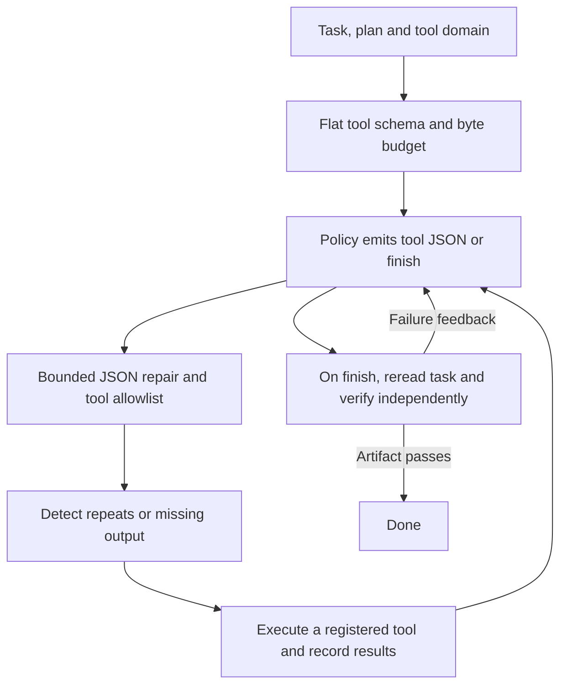
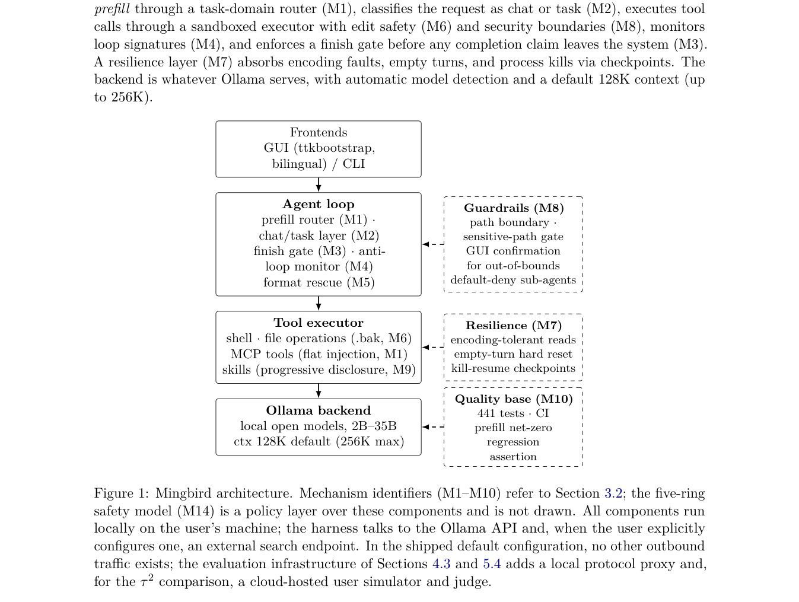

<!-- source-sha256: fc0418818d5ef7fc01c23fdf6b6ca933c97c37269bd29cbe29dc7b64715e28ce -->

[简体中文](README.md) · English

# Mingbird: An agent harness for small local models

> **L1 portable runtime diagnostic:** Actually executes tools, checks artifacts and rejects false completion. Its policy is scripted, not a real small-model success rate.

## Paper information

| Field | Details |
|---|---|
| Paper | [arXiv 2610.02001](https://arxiv.org/abs/2610.02001) |
| Institution | University of Science and Technology Beijing (first author Hao Wang) |
| First public release | 2026-10-01 (arXiv v1) |
| Original source code | Yes: [Mingbird/Mingbird-agent](https://github.com/Mingbird/Mingbird-agent), Apache-2.0 |
| Adapter | `mingbird` (Python mechanism API) |
| Local reproduction code | [`src/auto_research/agent_research/mingbird.py`](https://github.com/daiwk/auto-research/blob/main/src/auto_research/agent_research/mingbird.py) |

## Original paper summary

### Background and main changes

Domain routing and flat schemas reduce the tool-call load on small models. On claimed completion, reintroduce the original task and plan and verify artifacts. Repeated calls or loops with no output trigger corrections, and common JSON errors get bounded recovery. This is an inference harness improvement, not a new backbone.

<!-- paper-figure:start -->
### Key figure from the paper

> **Figure 1:** Core architecture, modules and connections. From the [paper](https://arxiv.org/abs/2610.02001); copyright belongs to the authors. Click for the source.
<!-- paper-figure:end -->

### Core equations

Context is constrained by $|\operatorname{UTF8}(prefill)|\le B$; character counts are not byte counts. Tools with more than 8 parameters retain only required fields. A call signature combines the tool name with canonical JSON arguments. Corrective feedback triggers at 6 identical signatures in total or 15 consecutive no-output calls.

### Offline and online results

The paper reports 0.886 across 288 LRAB model-task units against 0.631/0.479/0.405, and τ²-related scores of 0.856/0.791/0.737. It discloses limitations including a custom benchmark and single runs on one machine. No production A/B is reported. Safeguards are not a demonstrated secure sandbox.

## Local reproduction

`PYTHONPATH=src python scripts/run_oct04_seven_papers.py` actually writes a file in a temporary directory. The first finish is rejected because the file does not exist. The policy then writes the file and passes a second check. The [three-seed artifact](metrics/mechanism-seeds42-44.json) records false completion rejection, actual files and call counts, not model accuracy.

- `flat_prefill`: routing, required-field validation and a strict UTF-8 budget.
- `rescue_tool_call`: JSON, fenced JSON and double-encoded JSON; registered tools only, never `eval`.
- `run_task`: policy sees only task, plan and trajectory; an external callback checks success, and failures are fed back for correction.
- `LoopMonitor`: canonical argument ordering; blocks the sixth repetition before execution.

## Scope

No full Windows GUI or voice product, LRAB/τ² run, or actual local LLM integration. Registered tools inherit caller privileges. This is not isolation and must not be used to register arbitrary shells. External verification must not reveal private information the policy is not authorized to see.
