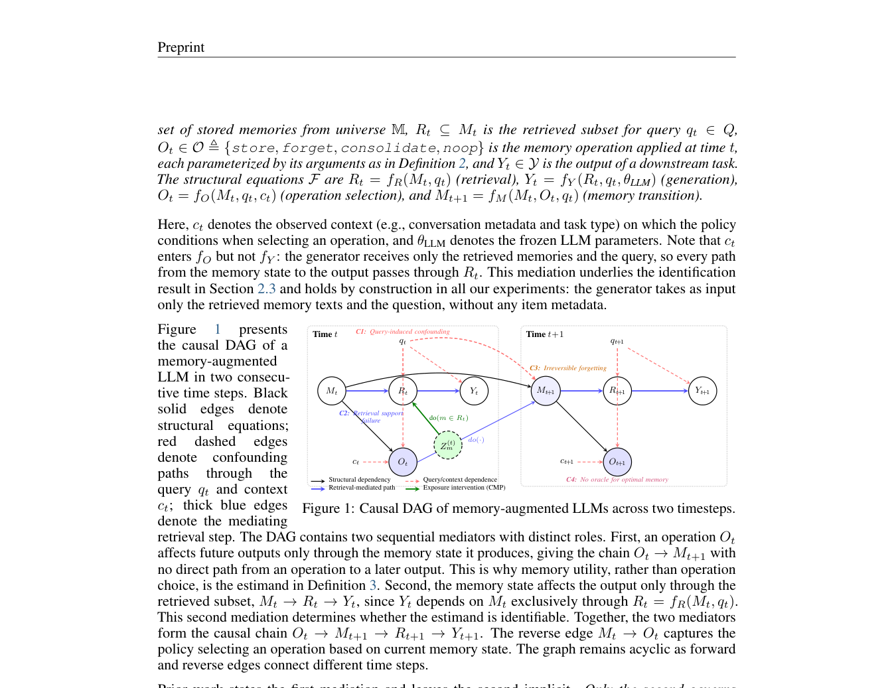

<!-- source-sha256: 964e66a4528f87902683f8cea525cd17bff0229872c04bb0a922e51a59085df4 -->

[简体中文](README.md) · English

# Causal Memory Policy: Memory utility under retrieval interventions

> **L1 causal measurement protocol.** Balanced randomized exposure, Hájek estimation and uncertainty-aware single-query decisions are implemented, not a validated long-term memory pruning policy.

## Paper information

| Field | Details |
|---|---|
| Paper | [arXiv 2610.02070](https://arxiv.org/abs/2610.02070) |
| Institution | Illinois Institute of Technology (first author Arman Behnam) |
| First public release | 2026-10-01 (arXiv v1) |
| Original source code | The paper links an [anonymous release](https://anonymous.4open.science/r/cmp-release-D0C3/). Access failed during this review; upstream code was not run. |
| Adapter | `causal-memory-policy` (Python mechanism API) |
| Local reproduction code | [`src/auto_research/agent_research/causal_memory_policy.py`](https://github.com/daiwk/auto-research/blob/main/src/auto_research/agent_research/causal_memory_policy.py) |

## Original paper summary

### Background and main changes

Retrieved memories correlate with task difficulty, so pruning based directly on success or failure is biased. CMP reserves balanced randomized exposure slots in a fixed candidate pool. Each memory then has estimable treatment and control samples, and utility with a standard error protects uncertain memories.

<!-- paper-figure:start -->
### Key figure from the paper

> **Figure 1:** Overall design and components. From the [paper](https://arxiv.org/abs/2610.02070); copyright belongs to the authors. Click for the source.
<!-- paper-figure:end -->

### Core equations

The balanced design has $k$ exposures in each row and $\lfloor Tk/P\rfloor$ or $\lceil Tk/P\rceil$ in each column. $\hat\tau=\bar Y_{Z=1}-\bar Y_{Z=0}$, $SE=\sqrt{s_1^2/n_1+s_0^2/n_0}$.

$$
g_\lambda(z)=\lambda z\Phi(z)+z\Phi(-z)+(\lambda-1)\phi(z),\qquad z=\hat\tau/SE.
$$

Forget only when $g_\lambda(z)<0$. Insufficient support rejects estimation; infinite uncertainty returns noop. **Fixed slots mean that exposing one memory changes the distribution of other memories.** The estimate is a net effect under this exposure design, not an independent additive coefficient.

### Offline and online results

The paper focuses on identifiable per-query utility and the cost of mistaken deletion, not memory retention across queries, candidate-pool selection or long-term policy. No production A/B is reported.

## Local reproduction

`PYTHONPATH=src python scripts/run_oct04_seven_papers.py` uses 12 memories, 600 retrievals and 2 slots each, with synthetic external outcomes for three seeds. Every memory is exposed exactly 100 times. The [artifact](metrics/mechanism-seeds42-44.json) retains positive and negative utilities, standard errors and forget decisions.

`balanced_exposure` builds a degree-constrained design before random permutation and edge swaps. `estimate_utility` requires at least two observations per arm. The design requires a fixed pool and known randomization; ordinary production observation logs cannot substitute for randomized experiments.

## Scope

Real LLM retrieval and cross-query memory deletion were not run. Recovery of synthetic utilities is not agent answer accuracy and does not enter capability rankings or Evolve promotion evidence.
