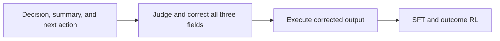
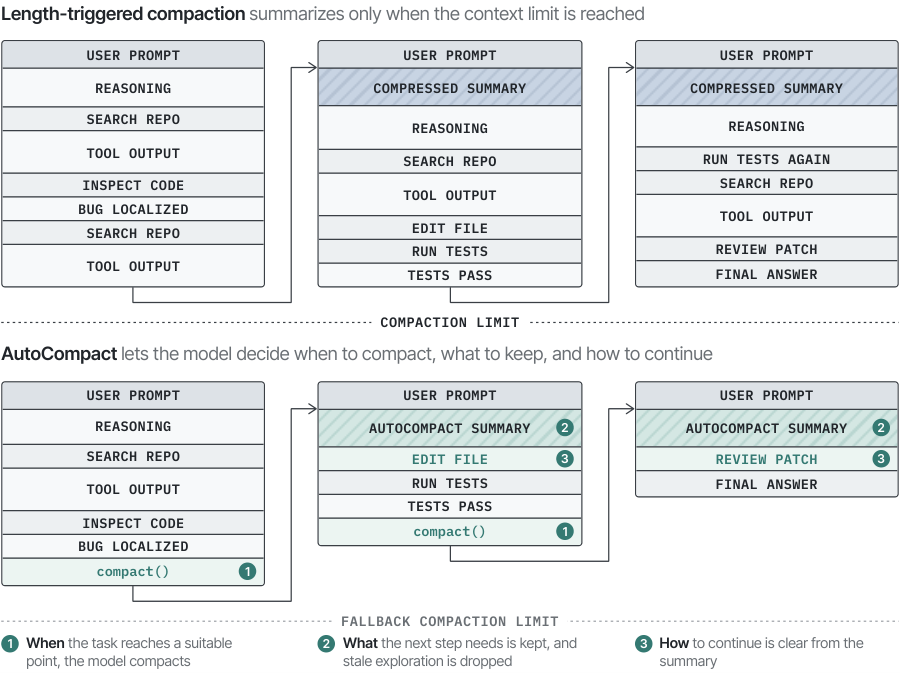

# AutoCompact: Learning When to Compact Context in Long-Horizon Coding Agents

<!-- source-sha256: 386048334384abcc2c181378b6344a5ec65a822875b817a27c02c3f5ed375555 -->

[简体中文](README.md)

> L1 diagnostic of the in-place three-field correction contract; no coding-agent training or SWE container run.

## Paper information

| Field | Details |
|---|---|
| Paper | [arXiv v1](https://arxiv.org/abs/2610.02163) |
| Institution | The paper's first page does not list an affiliation for the first author. |
| First public release | 2026-10-01 (arXiv v1) |
| Author code | No public author implementation found as of 2026-10-03. |
| Local adapter or method key | `autocompact` |
| Local reproduction code | [`src/auto_research/agent_research/latest_20261003.py`](https://github.com/daiwk/auto-research/tree/main/src/auto_research/agent_research/latest_20261003.py) |

## Paper method and evidence

A judge assesses when to compact, what the working summary should say, and what the next action should be. The corrected output is executed directly in the environment, then learned with SFT and outcome RL.

<!-- paper-figure:start -->
### Original paper figure

Figure 1 shows the overall method and its components. From the [original paper](https://arxiv.org/abs/2610.02163); copyright remains with the authors.
<!-- paper-figure:end -->

### Core equation

Apply $(d,s,a)\leftarrow JudgeCorrect(d,s,a)$ before executing.

### Reported results

The paper reports +9.2 points on SWE-bench Verified and +5.0 on SWE-PolyBench Verified.

## Local reproduction

Compare with the mechanism disabled/default state. The [three-seed diagnostic](metrics/mechanism-seeds42-44.json) is `diagnostic_only=true`; there is no formal relative gain or capability ranking.
