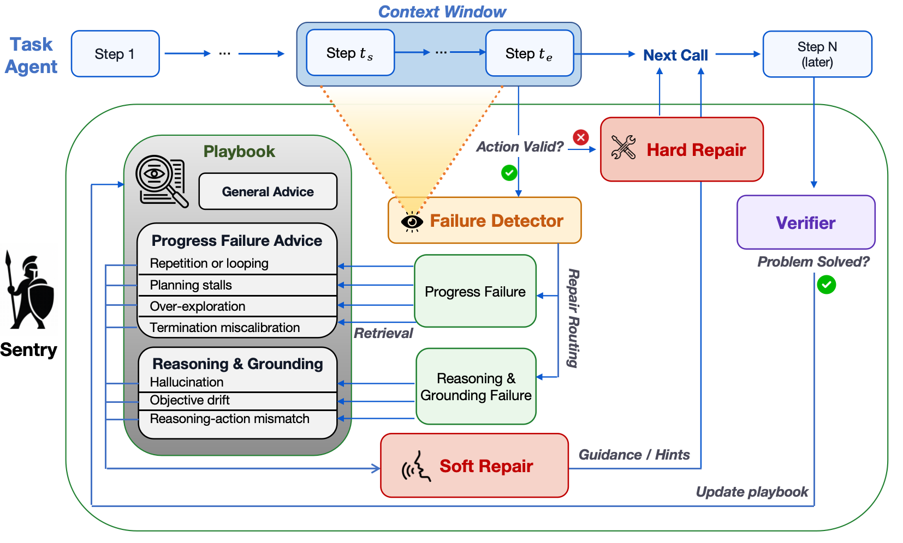

# Sentry: Retrieve experience after a failure, and store it only after recovery

<!-- source-sha256: d2b7c8739c2fd65e2e254ac197bd1148eaa0749d80ddf4ecf1fe04b6e44f58ee -->

[简体中文](README.md)

> Independent controller with a real checkpoint on a small tool task; no WebShop, AppWorld, SWE-bench, or Mind2Web reproduction.

## Paper information

| Field | Details |
|---|---|
| Paper | [arXiv 2610.02994 v1](https://arxiv.org/abs/2610.02994) |
| Institution | Stanford University; Changxiu Ji and Amy Lu are co-first authors. |
| First public release | 2026-10-02 (arXiv v1) |
| Author code | The [author repository](https://github.com/nuglifeleoji/Sentry) at `83064d18a99f47a0a8032049eaa2e1e4085351ad` had documentation, paper and images only; README commands are not released executable source. |
| Local adapter or method key | `sentry`, standalone failure-recovery API, not an Evolve operator. |
| Local reproduction code | [`sentry.py`](https://github.com/daiwk/auto-research/blob/main/src/auto_research/agent_research/sentry.py), [`sentry_public.py`](https://github.com/daiwk/auto-research/blob/main/src/auto_research/agent_research/sentry_public.py), [Runner](https://github.com/daiwk/auto-research/blob/main/scripts/run_sentry_checkpoint.py) |

## Paper method and evidence

Detect the failure before retrieving advice by category and tag rather than stuffing all experience into context. An external verifier observes subsequent progress without task reward, and writes to the playbook only after confirmed recovery. Invalid action formats use a separate hard-repair path.

<!-- paper-figure:start -->
### Original paper figure

The pinned author figure maps detection, conditional retrieval, recovery verification, and writing to separate states. Final answer scoring is outside the loop. From the [original paper](https://arxiv.org/abs/2610.02994); copyright remains with the authors.
<!-- paper-figure:end -->

### Core equation

Match failure category first, then rank by tag overlap and recency while diversifying primary tags. Defaults: recent window $W=5$, verification horizon $H=10$, and retrieval limit $k=5$. No write after unconfirmed recovery or during frozen test.

### Reported results

The [paper](https://arxiv.org/html/2610.02994v1#S5) compares runtime intervention and context evolution in four agent environments; not local results.

## Local reproduction

~~~bash
python -m pip install -e '.[post-training-gpu]' pyarrow
hf download Qwen/Qwen3-4B-Instruct-2507 --revision cdbee75f17c01a7cc42f958dc650907174af0554
mkdir -p data
curl -Lf 'https://huggingface.co/datasets/hotpotqa/hotpot_qa/resolve/1908d6afbbead072334abe2965f91bd2709910ab/distractor/validation-00000-of-00001.parquet' \
  -o data/hotpotqa-validation.parquet
PYTHONPATH=src python scripts/run_sentry_checkpoint.py \
  --dataset data/hotpotqa-validation.parquet \
  --output runs/sentry/results.json \
  --memory-cases 4 --held-out-offset 16 --held-out-cases 8 \
  --seeds 42,43,44
~~~

Check the pinned SHA-256 of the [official HotpotQA mirror](https://huggingface.co/datasets/hotpotqa/hotpot_qa/tree/1908d6afbbead072334abe2965f91bd2709910ab/distractor), sort by question-ID hash, use four for memory, reserve the next 16 for interface development, and evaluate the following eight. All are official dev, not official test. The original corpus is CC BY-SA 4.0 and not bundled. Qwen3-4B-Instruct-2507 calls search/read/finish; read one document before submitting. Tools contain public documents only, no gold or supporting facts. An external scorer reads answers after the full trajectory. Both arms share questions, seed, tools, and 14 steps; extra detection and verification are costed separately, not matched tokens.

| Seed | Baseline EM | Sentry EM | Frozen experiences |
|---|---:|---:|---:|
| 42 | 3/8 | 2/8 | 2 |
| 43 | 3/8 | 4/8 | 2 |
| 44 | 4/8 | 1/8 | 2 |
| Mean | 41.67% | 29.17% | 2 |

A100 measurements on 2026-10-07 are three generation seeds over the same eight questions, not 24 distinct tasks. Sentry underperformed. Baseline/Sentry averaged 2.58/3.13 actions and 1,534.96/3,308.67 agent tokens per item. Sentry used another 27,956 manager tokens per seed, including memory collection. All seeds actually retrieved conditionally. [Per-item sanitized metrics and trace hashes](metrics/checkpoint-seeds42-44.json) retain costs/events/source but not full text or outputs. [A100 receipt](../../gpu-validations/oct07-agent-search-a100.json) verifies pinned weight shard and source hashes for frozen inference, not training. Incorrect recovery judgments may contribute; no held-out retuning.

This is a read-only document tool, not the original browser or coding environment. Development failures (copying the action enumeration and inadequate tool documentation) were excluded from the isolated set; scoring and gold isolation were not relaxed. Preserve zero when no soft failure, verified recovery, or new experience occurs. Hard repair and hand-authored memory are not learning. CPU tests cover deferred verification, retrieval, invalid output, and frozen writes. No Evolve promotion.
