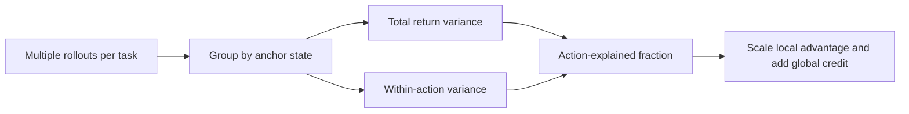
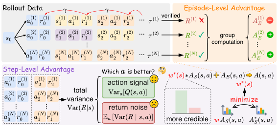

# AdaStep: Scale Agent RL step advantages by reliability

<!-- source-sha256: ecd6aa135b7917da58b2a2462f158635f1f5e6930f9b389d9db69e00252ba093 -->

[简体中文](README.md)

> L1 diagnostic for Equations 17–18: shared anchors, action variance decomposition, sparse fallback, and combined advantages. No policy training or benchmark evaluation.

## Paper information

| Field | Details |
|---|---|
| Paper | [arXiv 2610.03223 v1](https://arxiv.org/abs/2610.03223) |
| Institution | Tsinghua University (first author Xin Wang); collaborators include Nanjing University and Xiaomi Inc. |
| First public release | 2026-10-02 (arXiv v1; announced October 5) |
| Author code | No author code found in the reviewed HTML as of 2026-10-05. |
| Local adapter or method key | `adastep` (standalone L1 mechanism API; not a full reproduction adapter). |
| Local reproduction code | [`src/auto_research/agent_research/adastep.py`](https://github.com/daiwk/auto-research/blob/main/src/auto_research/agent_research/adastep.py); [`scripts/run_adastep_20261005.py`](https://github.com/daiwk/auto-research/blob/main/scripts/run_adastep_20261005.py) |

## Paper method and evidence

Terminal rewards do not identify useful steps. A local return estimate at a shared anchor state can be noisy because later paths differ after the same action. AdaStep uses no additional critic; it estimates the share of return variance explained by actions. When within-action noise dominates, downweight the local correction and keep global credit.

<!-- paper-figure:start -->
### Original paper figure

Figure 2 shows action-explained variance versus later path noise in episode and step credit. From the [original paper](https://arxiv.org/abs/2610.03223); copyright remains with the authors.
<!-- paper-figure:end -->

### Core equation

For observed discounted return R at anchor s, use empirical population variances with denominators $N_s$ and $n_{s,a}$:

$$
\hat w(s)=1-\frac{\sum_a \hat p(a\mid s)\,\widehat{\mathrm{Var}}(R\mid s,a)}{\widehat{\mathrm{Var}}(R\mid s)},
\qquad A_{i,t}=A_E(\tau_i)+\hat w(s_{i,t})A_S(s_{i,t},a_{i,t}).
$$

Estimate only with at least two actions, at least two samples per action, and positive total variance. Otherwise default to $w=1$. Equal returns give zero local advantage. The local API can normalize local advantage by group SD, but estimates weights from raw returns.

### Reported results

The paper compares Qwen3-1.7B/4B and Qwen2.5-7B-Instruct with GiGPO/HGPO on ALFWorld, WebShop, and ScienceWorld, reporting improvements in several settings and roughly 1% added credit computation time. This is not a local timing or production A/B.

## Local reproduction

~~~bash
PYTHONPATH=src python scripts/run_adastep_20261005.py
python -m pytest tests/test_adastep_20261005.py
~~~

The [three-seed synthetic mechanism receipt](metrics/variance-seeds42-44.json) reports mean weight about 0.974 where actions explain returns and 0.026 with only later noise. This is not task success. Tests cover population variance, sparse fallback, all ties, and normalization. Inputs are task IDs, anchor states, actions, discounted returns, and global advantages; grouping by task and state prevents collisions. No gold, live environment, Qwen updates, task benchmarks, or matched GiGPO control. diagnostic_only=true and formal_comparison=false. A full run needs same-task rollouts, trustworthy anchor alignment, isolated validation/test, optimization, multi-seed controls, and a sanitized A100/A30 receipt for any CUDA path.
