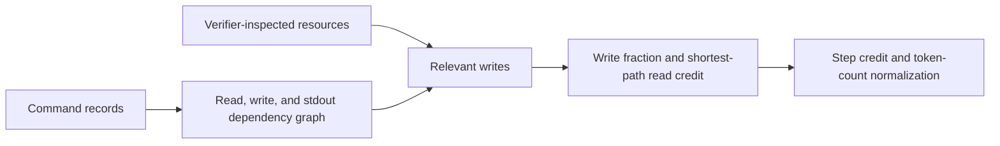
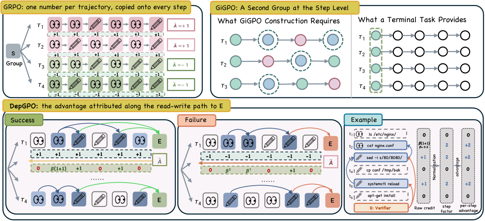

# DepGPO: Assign Agent RL credit using terminal-command dependencies

<!-- source-sha256: b7c6c29e82f4406273e531290a38874af5065c678f833476e7b90a26e0cedb0f -->

[简体中文](README.md)

> L1 diagnostic of record-level dependencies, relevant writes, supporting reads, and step/token advantage normalization; no live terminal tracer, verifier execution, or Qwen policy training.

## Paper information

| Field | Details |
|---|---|
| Paper | [arXiv 2610.03634 v1](https://arxiv.org/abs/2610.03634) |
| Institution | Southeast University (first author Yu Li); collaborators include Huawei Noah’s Ark Lab. |
| First public release | 2026-10-02 (arXiv v1; announced October 5) |
| Author code | No public implementation found in the paper or public repository search as of 2026-10-06. |
| Local adapter or method key | `depgpo` (standalone L1 mechanism API, not a complete reproduction adapter). |
| Local reproduction code | [`src/auto_research/agent_research/depgpo.py`](https://github.com/daiwk/auto-research/blob/main/src/auto_research/agent_research/depgpo.py); [`scripts/run_depgpo_20261006.py`](https://github.com/daiwk/auto-research/blob/main/scripts/run_depgpo_20261006.py) |

## Paper method and evidence

A terminal verifier rewards completed trajectories, while GRPO gives the same advantage to every generated token. DepGPO traces reads back to non-overwritten writes and builds edges for trusted stdout reuse, then walks backward from the files, ports, and processes actually inspected by the verifier.

<!-- paper-figure:start -->
### Original paper figure

Figure 2 contrasts trajectory-wide GRPO and GiGPO grouping with read/write-based step credit. From the [original paper](https://arxiv.org/abs/2610.03634); copyright remains with the authors.
<!-- paper-figure:end -->

### Core equation

Write credit is the fraction of a command's write records that survive in a verified file or feed a later relevant writer without being overwritten. A read-only command sums reachable relevant-write credits discounted by shortest distance $\beta^d$ (default $\beta=0.5$). Sum commands within a step, subtract the trajectory minimum, and normalize to step mean 1. Missing or tied credit falls back to GRPO unit weights. Renormalize by loss-token count to preserve the token-weighted mean and original advantage sign.

### Reported results

Qwen3.5-9B / Qwen3.6-27B in SETA / TMAX settings show improved Terminal-Bench pass@1 and steadier training in the [paper](https://arxiv.org/html/2610.03634); not local scores.

## Local reproduction

~~~bash
PYTHONPATH=src python scripts/run_depgpo_20261006.py
PYTHONPATH=src python -m pytest tests/test_depgpo_20261006.py
~~~

The [mechanism receipt](metrics/trace-mechanism.json) uses four hand-structured commands: supporting read, indirect write, final write, and irrelevant write. Tests cover overwrite isolation, write denominators, shortest paths, fallback, negative advantages, and preservation under unequal token lengths.

Inputs must come from a trusted tracer: read/write records, changed lines or whole-file marks, stdout provenance, inspected resources, and policy-loss token lengths. The code neither parses shell commands nor infers stdout matches. Exclude values already in prompts, remove verifier-generated files, filter system noise, and normalize paths. No gold or plans are read. This is diagnostic_only=true, formal_comparison=false, with no dashboard capability or Evolve promotion. A full run would need live controlled traces, verifier resources, multiple policy rollouts per task, actual GRPO/DAPO updates, validation-only checkpoint selection, isolated test, matched-budget multi-seed controls, and an A100/A30 receipt for CUDA.
