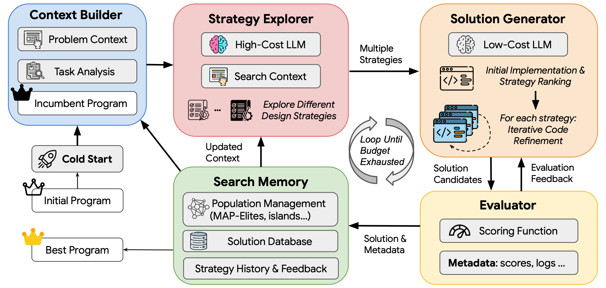

<!-- source-sha256: 23347ceb5ba34f1dc315c580bbf7b9951de23b79838d6dab5ce16a45785dba57 -->

[简体中文](README.md) · English

# FrugalEvo: Program evolution with stronger and weaker models under a cost cap

> Independent implementation and small-budget validation on a public task. This does not reproduce the paper's API models, dollar costs, or full 20-task results. It is not integrated with the unified Evolve controller.

## Paper information

| Field | Details |
|---|---|
| Paper | [arXiv 2610.03675 v1](https://arxiv.org/abs/2610.03675) |
| Institutions | National University of Singapore (first author Hui Chen); coauthors from University of Washington, Princeton and Stanford |
| First public release | 2026-10-02 |
| Original source code | [Authors' implementation](https://github.com/chchenhui/frugalevo), Apache-2.0; checked revision `82f7b739110944bf3e8737db303a302a568e7327` |
| Adapter | `frugalevo` is a standalone program-search API, not a general `reproduce` adapter. |
| Local reproduction code | [`frugalevo.py`](https://github.com/daiwk/auto-research/blob/main/src/auto_research/agent_research/frugalevo.py), [`program_sandbox.py`](https://github.com/daiwk/auto-research/blob/main/src/auto_research/agent_research/program_sandbox.py), [runner](https://github.com/daiwk/auto-research/blob/main/scripts/run_frugalevo_checkpoint.py) |

## Original paper summary

### Background and main changes

FrugalEvo separates costly strategy proposals from cheaper execution and code refinement, then measures search efficiency over the entire best-score trajectory under the budget. Try and rank several strategies; retain the parent and add feedback after failures; reanchor after improvements; keep diverse programs in an island archive.

<!-- paper-figure:start -->
### Key figure from the paper

[](https://github.com/chchenhui/frugalevo/blob/82f7b739110944bf3e8737db303a302a568e7327/assets/frugalevo_overview.png)

> From the [paper's](https://arxiv.org/abs/2610.03675) author repository; copyright belongs to the authors. The strong/weak roles, evaluation and archive map to three separate local interfaces.
<!-- paper-figure:end -->

### Formula and paper results

Let $c$ be cumulative call cost and $s^*(c)$ the best valid score at that cost. BA-AUC for budget $B$ is $\int_0^B s^*(c)\,dc$. It rewards finding good programs earlier, not merely the final evaluation score. The authors compare evolution methods on math, systems and algorithm optimization tasks. See [paper experiments](https://arxiv.org/html/2610.03675v1#S3) for API prices and results, which cannot be directly converted to the local token budget.

## Local reproduction

Requires Linux, working bubblewrap/prlimit, CUDA and predownloaded public checkpoints. Generated programs run with no network and no workspace, credential or model-cache mounts. If the sandbox cannot start, execution is refused; there is no raw `exec` fallback.

The prompt forbids files and subprocesses, but the actual security boundary is namespaces, a read-only system runtime and resource limits, not a seccomp ban on every subprocess. The isolated namespace still has a temporary directory. `scripts/validate_program_sandbox.py` checked these limits on real Linux; it is not a formal security proof.

```bash
python -m pip install -e '.[post-training-gpu]'
hf download Qwen/Qwen2.5-7B-Instruct --revision bb46c15ee4bb56c5b63245ef50fd7637234d6f75
hf download Qwen/Qwen3-4B-Instruct-2507 --revision cdbee75f17c01a7cc42f958dc650907174af0554
PYTHONPATH=src python scripts/run_frugalevo_checkpoint.py \
  --output runs/frugalevo/results.json --budget 40000 \
  --max-calls 30 --max-tokens 768 --seeds 42,43,44
```

The models are pinned Qwen2.5-7B-Instruct and Qwen3-4B-Instruct-2507. The runner accepts local cache directories and does not upload models. A larger model is not guaranteed to be stronger. JSON retains model revisions, actual tokens per call, full generated code, feedback, strategies and cost curves, including costs of invalid programs and malformed responses.

Both complete weights total about 22 GB; reserve download space and GPU memory. No quantization or CPU fallback. Linux also needs `bubblewrap` and `util-linux` (for `prlimit`) and unprivileged user namespaces. After download, the script loads local caches only. If overriding directories with `--large-checkpoint` or `--small-checkpoint`, verify they match the stated revisions.

The public objective is to pack 26 circles into a unit square and maximize the sum of radii. Code returns only centers and radii. A trusted checker independently verifies finite values, boundaries and non-overlap, ignoring model-reported scores. The comparator is weak-model iterative search from the same initial program under the same budget caps. Both also have a 30-call cap, so actual spend need not match.

### A100 measurements (2026-10-07)

Each method has at most 40,000 weighted tokens and 30 calls. All three seeds start from the same valid grid program with radius sum 2.16667.

| Seed | Weak model final best | FrugalEvo final best | Weak model BA-AUC / B | FrugalEvo BA-AUC / B |
|---|---:|---:|---:|---:|
| 42 | 2.40000 | 2.40000 | 2.31671 | 2.19131 |
| 43 | 2.40000 | 2.40000 | 2.32273 | 2.34223 |
| 44 | 2.40000 | 2.16667 | 2.32876 | 2.16667 |
| Mean | 2.40000 | 2.32222 | 2.32273 | 2.23340 |

**The local results do not establish a benefit from collaboration.** FrugalEvo ran 4/5/5 strategy pilots and 9/7/7 refinements, not merely one strong-model call. Average spend was 38,820 weighted tokens versus 29,253.67 for the weak model, which hit the 30-call cap first. Caps match; realized cost does not. BA-AUC carries the current best score over unused budget rather than dropping early-stop intervals.

During development, the task's “output Python” instruction interfered with strategy JSON and produced format failures. The output contract was fixed; failed pilots are not mixed into the final three-seed results. Formal-run artifacts retain every failure and cost, including invalid programs.

[Per-seed metrics, cost curves and program hashes](metrics/checkpoint-seeds42-44.json); [real GPU and sandbox receipt](../../gpu-validations/oct07-agent-search-a100.json).

## Scope

- Shared-prefix byte ordering is implemented. Transformers currently has **no cross-request KV prefix cache**, with `cached_input_tokens=0`; the paper's cache speedup is not reproduced.
- Cost is a fixed weighted input/output token unit (large model 2, small model 1), not dollars or measured energy.
- The island archive buckets by fixed code length and word-set difference, not the authors' dynamic normalization descriptors. Tasks require standard-library programs rather than the authors' NumPy interface.
- This directly optimizes a public math objective with no hidden test distribution. It does not establish generalization or qualify for Evolve promotion.

The GPU receipt validates frozen-model generation and execution of candidate programs. It is **not weight-training evidence** and does not upgrade the small-task results to formal capability improvement.
