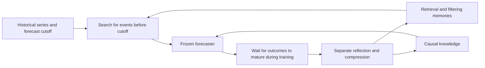
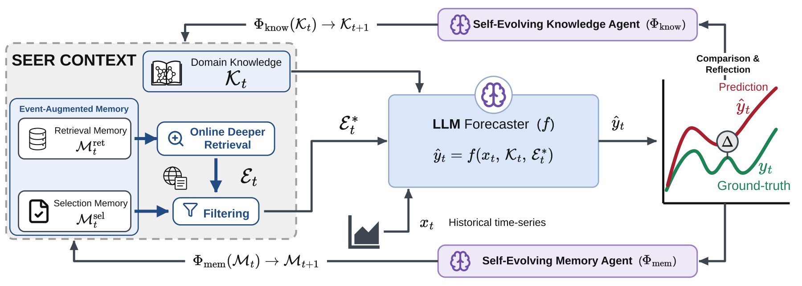

<!-- source-sha256: 451090438577f89b613e97f7e8d1ad1d7e33d718bb3f0eba992d505514d1da69 -->

[简体中文](README.md) · English

# SEER: Improving forecasts with event memory and causal knowledge

> High-priority historical addition. **Too costly to reproduce (review DONE).** No local capability result or runnable Evolve operator.

## Paper information

| Field | Details |
| --- | --- |
| Paper | [arXiv 2610.04109v1](https://arxiv.org/abs/2610.04109v1); [pinned full text](https://arxiv.org/html/2610.04109v1) |
| Institutions | First author Mingtian Tan lists Google Cloud AI Research first and University of Virginia second. |
| First public release | 2026-10-02 22:30:10 UTC (arXiv v1; not overridden by an institutional catalog date) |
| Original source code | [BennyTMT/SEER](https://github.com/BennyTMT/SEER) exists. Its inspected root contained README, assets, paper and citation only; executable core code was not confirmed. |
| Local adapter/key | `seer-forecasting` is a research-material key; `adapter: null`. |
| Local reproduction code | None; only this page and `src/auto_research/paper_specs/catalog/agent-research/seer-forecasting.json`. |

## Original paper summary

### Background and main changes

Numerical history can miss external events, and ordinary RAG does not revise retrieval after forecast errors. SEER freezes the predictor and separates context into retrieval memory, filtering memory and causal knowledge. Update the two memories and knowledge separately from forecast trajectories only after outcomes become observable. Compress them at capacity instead of appending indefinitely.

Redrawn from Figure 2 and Section 3; see the [original figure and method](https://arxiv.org/html/2610.04109v1).

<!-- paper-figure:start -->
### Key figure from the paper

> **Figure 2:** Learning loop between predictor, retrieval/filtering memories, and causal knowledge. See the text for the boundary between training feedback and frozen testing. From the [paper](https://arxiv.org/abs/2610.04109v1); copyright belongs to the authors. This is the authors' SVG rendered to PNG, not the Mermaid redraw above. Click for the original.
<!-- paper-figure:end -->

### Core equations

Sections 3.2–3.3 separate event expansion and filtering:

$$
\hat y_t=f(x_t,R(\mathcal E_t,\mathcal K_t,\mathcal M_t)),\quad
R=(\rho_{\mathcal M^{sel}}\circ\sigma_{\mathcal M^{ret}}(\mathcal E_t),\mathcal K_t).
$$

After outcomes mature, update inside the learning window:
$\mathcal M_{t+1}=\mathcal C\circ\Phi_{\rm mem}(\xi_t,\mathcal M_t)$ and
$\mathcal K_{t+1}=\mathcal C\circ\Phi_{\rm know}(\xi_t,\mathcal K_t)$.
Freeze $\mathcal M,\mathcal K$ during test; test results cannot feed reflection. Both event occurrence and availability must satisfy the forecast cutoff. A model's claim that a news timestamp is correct is not independent verification.

### Offline and online results

Six domains cover areas such as weather, electricity, stocks, memory prices and event forecasts. Comparisons include four LLMs, numeric-only predictors, no-event controls and ordinary event RAG. Section 4 retains task and backbone differences; average gains on some settings do not imply gains everywhere. No production A/B is reported. These forecasting benchmarks are neither investment advice nor deployment evidence.

## Local reproduction and cost decision

The full Section 4.1 protocol uses Gemini 3.1 Pro/Flash, Claude 4.6 Sonnet/4.8 Opus, repeated search, LEAF fact checking and sequential backtesting. The costs of closed-model calls across six domains cannot be reliably bounded with cheap read-only checks. **Too costly to reproduce (review DONE).**

The [authors' repository](https://github.com/BennyTMT/SEER) currently verifies paper, figures and examples, not executable core code. There is no local code, metrics, GPU run or Evolve integration. Temporal filtering, feedback maturity and frozen testing could be future interfaces, but have not been implemented; hand-written causal rules cannot stand in for LLM reflection.
